# Appearance Design Tips

Anyone who has read this far should be able to feel the great freedom that Slide Code brings. In fact, precisely because Slide Code is so free, it is not an easy syntax to master. Careless use usually just looks abrupt, ugly, and un-fun. Below are some usage tips from the perspectives of aesthetics and playability.

To better integrate Slide Code into a chart that is primarily based on official Slides, the first thing to do is to make them "look like official Slides." Here are some examples that (Minepig thinks) might be decent. First, polyline Slides:

- `8B7K6[8:1]/1B3K5[8:1]`, where `1B3K5` can also be replaced with the standard syntax `1q5`, leveraging the `1-4/8-5` visual familiarity from standard Slides.

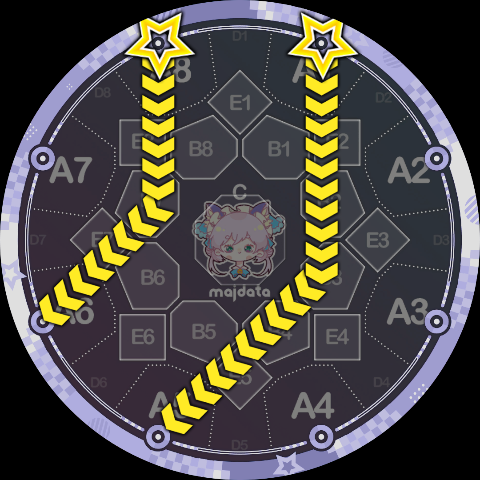

- `5B7K3[4:1]*-8-2[4:1]`, a kind of "F" letter shape. The presence of the official `5-8-2` makes `5B7K3` look much more reasonable.

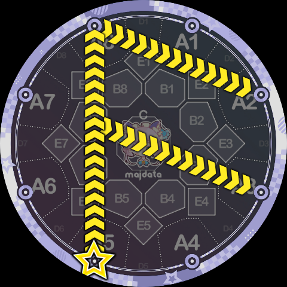

- `7-3[8:1]/1B3K5[8:1]`, looks like... an airplane? Here a `7-3` is used to cover the B3 kink of `1B3K5`. Kinks that are not in the C area are usually one of the things that make a Slide look ugly, so covering them improves the visual impression (and the composition looks more balanced).

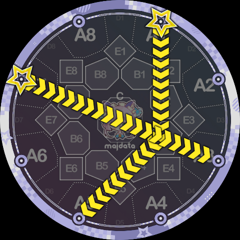

Next, curved Slides using track instructions. For curved Slides to "mimic" official Slides, the simplest approach is to use only one track, drawing something that looks like a ppqq-Slide using a `PK/QK` pattern such as `1P4K7`. We know that official ppqq-Slides initially head toward the C area before starting to rotate, and the exit segment after rotation is usually slightly longer than the entry segment before rotation, so Slide Code can also try to follow this direction. Let's look at some examples:

- `1P4K7[4:1]`, doesn't it look convincing? In reality this is not the reverse of any ppqq-Slide — it just looks like `1pp7`, but the real `1pp7` goes around circle 3, while this uses circle 4.

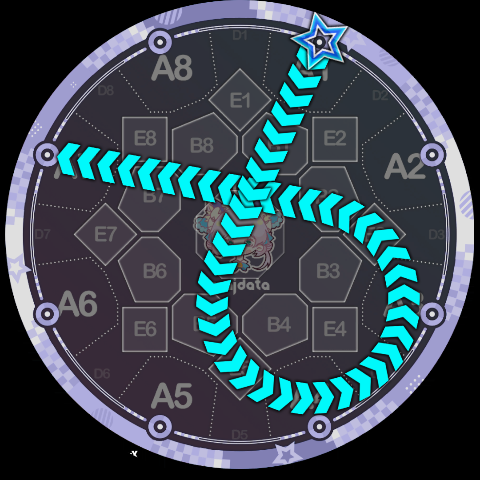

- This `1P5K8[4:1]` looks slightly less familiar, because the tangent entering circle 5 is a bit far from the C area. However, the path is symmetric, which can also increase aesthetics.

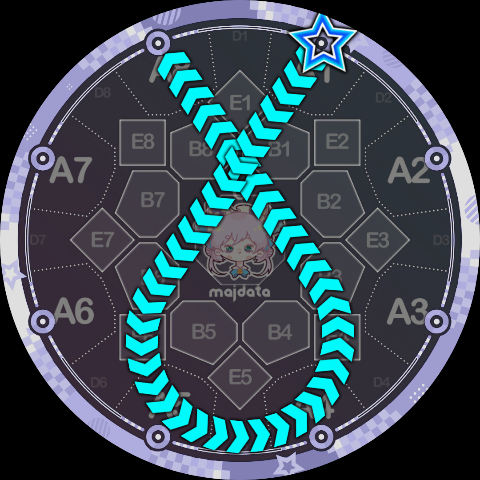

- Something like `1P2K8` below is relatively less attractive. Although it somewhat resembles the official `1pp8`, the center of gravity clearly leans to one side, looking "crooked." But there is a way to save it — see the technique below.

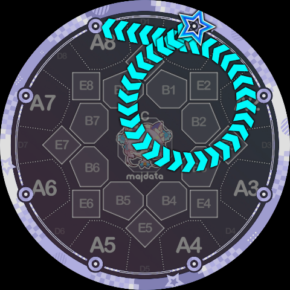

One way to improve aesthetics is to use multi-Slide patterns to draw an axially or rotationally symmetric shape, just as official charts have configurations like `1pp3[4:1]/5pp4[4:1]`. This way, even if a single Slide looks somewhat "off," a pair of Slides will look much better. Here are some examples:

- `1P2K8[4:1]/5P6K4b[4:1]`, the author feels this configuration is much more pleasing to the eye than the lone `1P2K8` above.

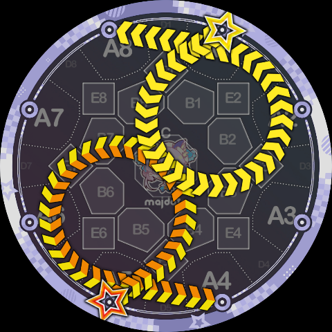

- Another example: `1Q4K7[4:1]/5Q8K3[4:1]`. A single one doesn't look great and differs significantly from official Slides, but as a rotationally symmetric pair it's actually decent.

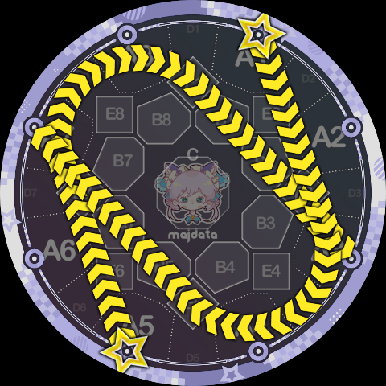

- An axial symmetry example: `6P6K8[4:1]/3Q4K1[4:1]`, used similarly to the official `3V58/6V41`.

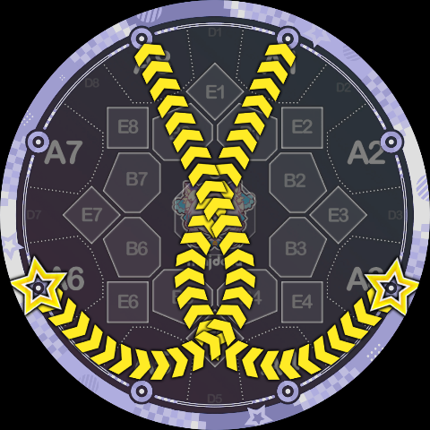

For Slides using multiple tracks, "mimicking" official Slides is basically impossible, so drawing these requires the chart designer's personal aesthetic and artistic ability. Typically, one should still follow rules of formal beauty such as symmetry, or use various letter/figure shapes to keep the Slide from looking out of place. Here are some examples:

- The yin-yang fish Slide `5P98CQ49K1` introduced in [Track-to-Track Transitions](./track-transitions) — no image repeated here.
- A lowercase-f letter shape, `1P2CQ6K5[8:1]/6-2[8:1]`. The inspiration for this shape comes from the "function shape" at 260 combo in the official chart of Override. Interestingly, flipping this shape yields a lowercase x or the Hebrew letter Aleph (א).

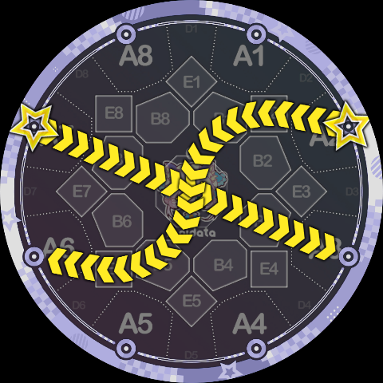

- `8Q87A6Q6K4[1:1]*P12A2P3K4[1:1]` — is this... a clover? An interesting shape regardless.

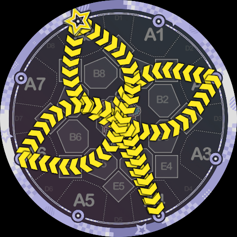

- `8P97B4Q0K1b[1:1]/4P93B8Q0K5[1:1]`, a meaningless multi-Slide that looks good purely by virtue of rotational symmetry. Feels a bit like forming a Rasengan?

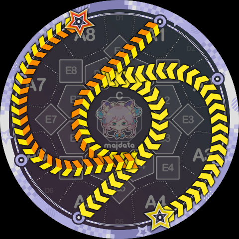

**Now some counter-examples — Minepig's opinion is that the following "look ugly":**

- `1P15K4` (blue), `1Q8CP4K5` (great), `1P8K7` (yellow) — inexplicable curves. If there is no compelling reason to use these shapes, it is recommended to simply use the official `1-4`, `1-5`, `1^7` or `1-7` instead. Similarly, `1Q3K4` should be replaced with `1^4`, and `1Q34K5` with `1>5`.

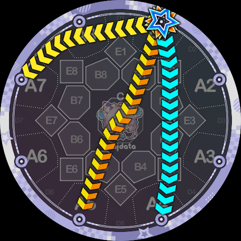

- `1P43K5` — this "capsule-shaped" pseudo-ppqq Slide is significantly less attractive than a normal ppqq-Slide. A single one looks very abrupt; if used, consider combining it with other shapes.

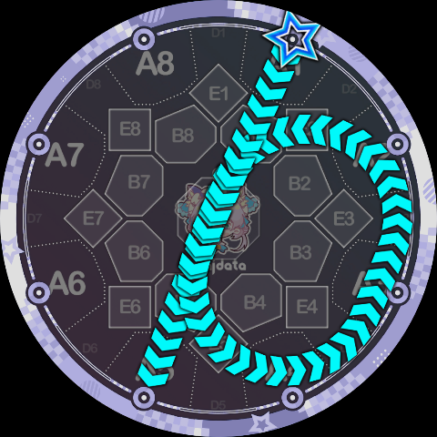

- `1P04K2` — an indescribable weirdness. This shape and the "capsule" above belong to the same class of problem: when drawing a track transfer, the original circular track is not sufficiently outlined, or the composition fails to capture the "two arcs + common tangent" look and instead appears as "one strange curve." In fact, adding a symmetric `5P08K6` would make this look much better (the universally useful rotational symmetry) — one reason being that the two Slide trajectories together outline the central circle.

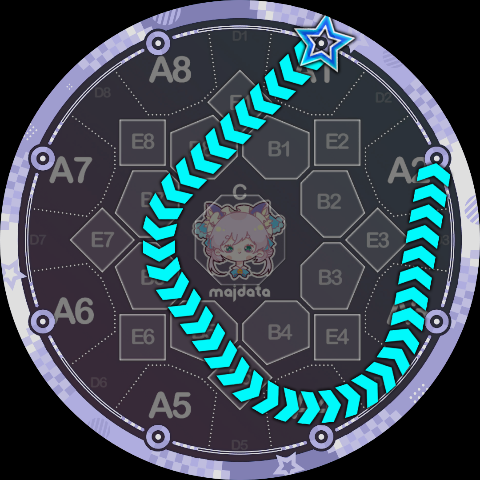

In summary, drawing beautiful Slides with Slide Code is a very difficult task with strong subjectivity. Sometimes, ugly Slides can unexpectedly express certain qualities of a song (chaos, quirkiness, etc.). Space is limited and not everything can be covered — chart designers need to experiment gradually in practice.
