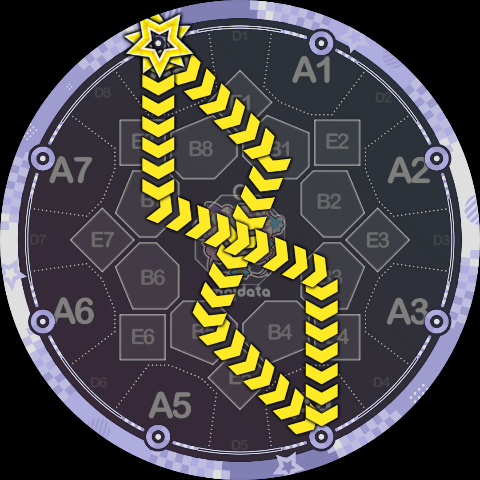
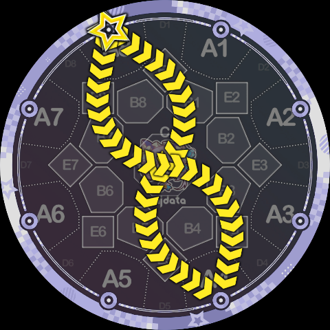
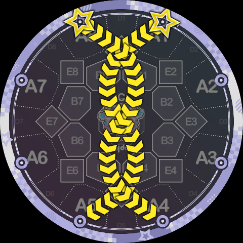
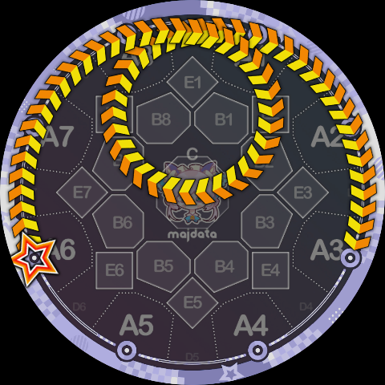
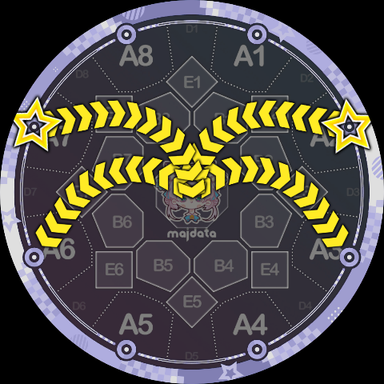
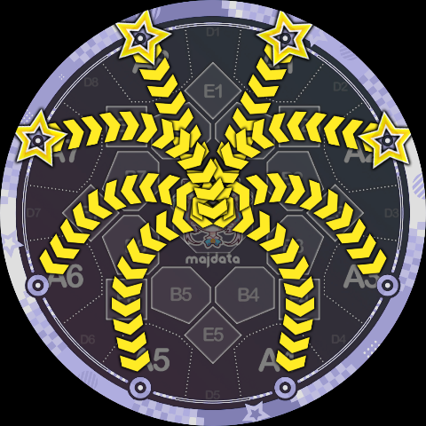
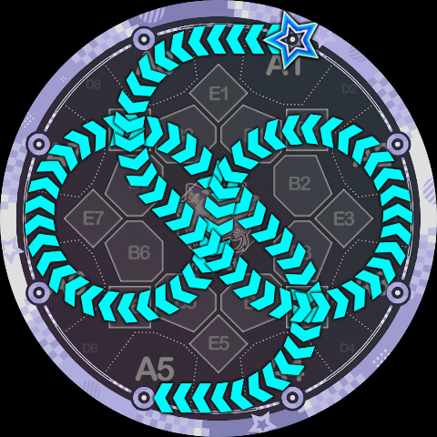

# Examples

Although many example images have already been included above, the possibilities of Slide Code are virtually endless. Below is a collection of Slide Code configurations gathered from various sources for reference.

`8B7B3K4[8:1]*B1B5K4[8:1]`

`8P1CQ5K4[8:1]*Q8CP4K4[8:1]`

`8Q8CP4K4[8:1]/1P2CQ6K5[8:1]`

`6Q919K3b[1:1]`

`7Q7CP6K6[8:1]/2P3CQ4K3[8:1]` (...crow flies?)

`7Q7CP6K6[1:1]/2P3CQ4K3[1:1]/8Q7CP5K5[1:1]/1P3CQ5K4[1:1]` (it's multi-pressed but this spider is really cool, right?)

`1P13CQ75K5[1:2]`

(Examples section to be continued...)
