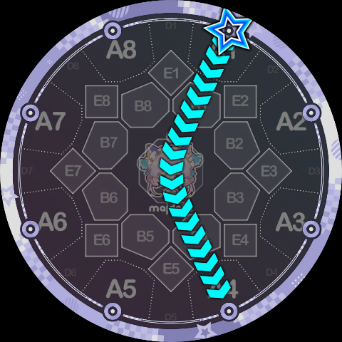
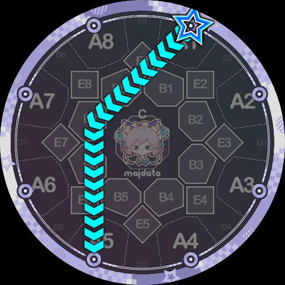
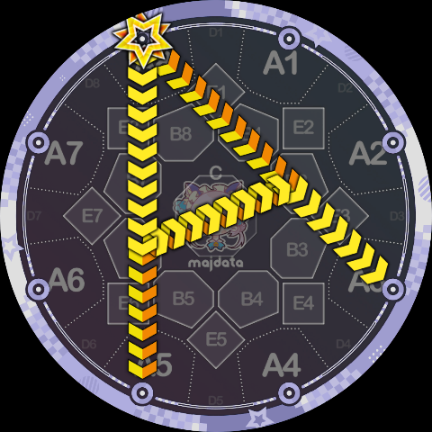
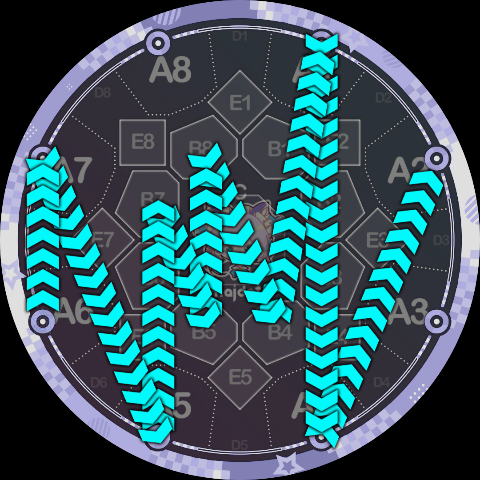

# Slide Code Overview

Slide Code is a new Slide syntax created by Minepig. A complex Slide path can be represented by a short sequence of characters, for example: `5Q9A1P98CQ49K5`. The earliest Slide Code demonstration video is [Believe in Rainbow, but maimai DX 2077](https://www.bilibili.com/video/BV1Uu42eqEWF/). MajdataViewX has supported writing Slide Code since version 6.1.0.

## Reading Guide

- [Node Instructions](./nodes)
- [Track Instructions](./tracks)
- [Expansion and Simai Compatibility](./shorthand)
- [Node and Track Connections](./node-paths)
- [Track-to-Track Transitions](./track-transitions)
- [Judgment Queue](./judgment)
- [Appearance Design Tips](./appearance)
- [Playability Design Tips](./playability)
- [Examples](./examples)

## Design Philosophy

The design philosophy of Slide Code is essentially: slice official Slide shapes into small segments, then splice them together into new Slide paths. Maimai players who are familiar with the game and pay attention to detail may notice that **official Slides can basically be viewed as fixed combinations of straight lines and circular arcs**. Slide Code uses these line segments, tangents, and arcs as building blocks for splicing.

The syntax of Slide Code contains only two types of characters:

* **Instructions**: uppercase letters `A, B, C, K, P, Q`
* **Parameters**: digits `0~9`

A Slide Code can be viewed as a sequence of `(instruction, parameter)` pairs in shorthand. They form a sequence that describes path segments one by one. Based on the specific meaning of the instructions, we can divide them into two groups: node instructions `A, B, C, K` (travel to a specific point); track instructions `P, Q` (rotate along a specific circle).

## Showcase

Using Slide Code you can draw the following Slides that cannot be written in traditional syntax:

Reverse ppqq-Slide:

Larger heart-shaped Slide:

One-handed heart:

An arc Slide that looks a lot like `1v4` but is not `1v4`:

A polyline Slide that looks a lot like `1p5` but is not `1p5`:

Updated but not necessarily hotter letter shapes:

Yin-yang fish:

Other indescribable things:

