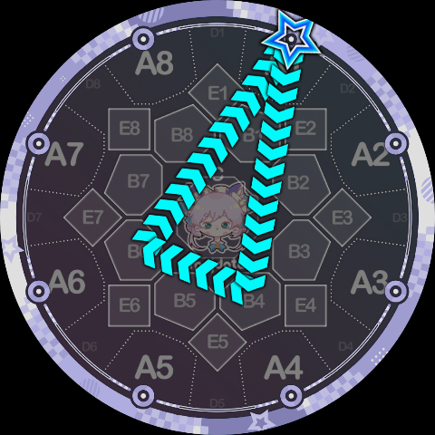
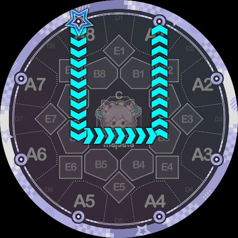

# Judgment Queue

To allow charts using Slide Code to be played on a real cabinet, a set of judgment queues must be devised for Slide Code. Fortunately, since Slide Code was designed from the start with the philosophy of "slicing and splicing official Slides," its judgment queues can also be obtained relatively easily through splicing.

Take the yin-yang fish Slide from [Track-to-Track Transitions](./track-transitions) as an example. Its judgment queue can be written naturally as: `A5, A4, A3, A2, A1, A8, A7, B6, C, B2, A3, A4, A5, A6, A7, A8, A1`.

Another example is the `1P5K7` below, which can obviously be spliced from the judgment queues of `3pp7` and `6qq1`, yielding `A1 B1/B8, B7/C, B6, A5, A4, B3, C, B7, A7`:

However, Slide Code still contains some shapes that do not exist in official Slides. For example, in the triangular Slide `1B46K1` below, the line segment from A1 to B4 and from B6 to A1 can be extracted from the tail judgment queue of a ppqq-Slide like `1pp6`, but B4 to B6 is entirely new. The judgment queue for this Slide was ultimately set to `A1, B1/B2, B3/C, B4, B5/C, B6, B7/C, B1/B8, A1`:

In other words, a line between two B-area positions separated by one key has a B-area and C-area OR judgment zone in between. Similarly, the judgment queue for the `6Q0380K4` below is `A6, B7, B8, B1, A2, A3, B4, B5/C, B6, A7, A8, B1, B2, B3, A4`:

There is also the following case of a line between B-area positions separated by two keys, with two OR judgment zones in between. The judgment queue for `8B63K1` is `A8, B7, B6, B5/C, B4/C, B3, B2, A1`:

Similar cases also exist in side-circle transfer paths, with lines between B-area positions separated by two keys. For example, the judgment queue for `4Q53175K5` below is `A4, A5, B6, B7/C, B8/C, B1, A2, A3, B4, B5/C, B6/C, B7, A8, A1, B2, B3/C, B4/C, B5, A6, A7, B8, B1/C, B2/C, B3, A4, A5`:

