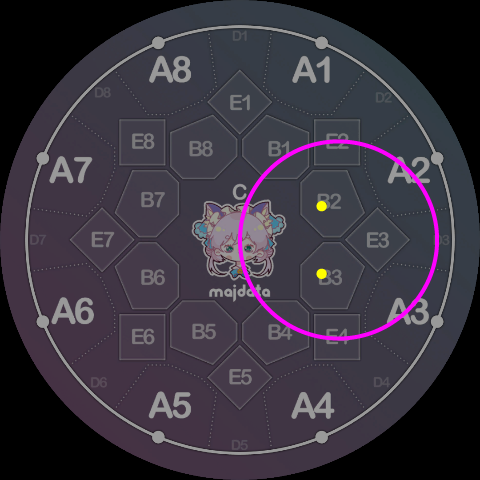
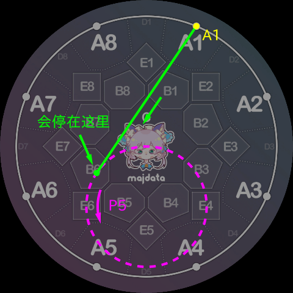
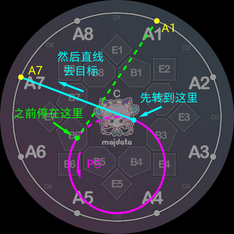
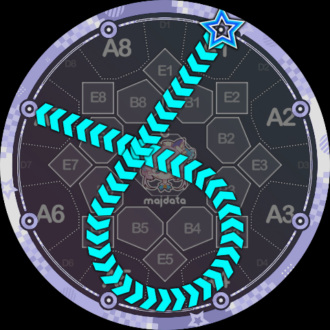
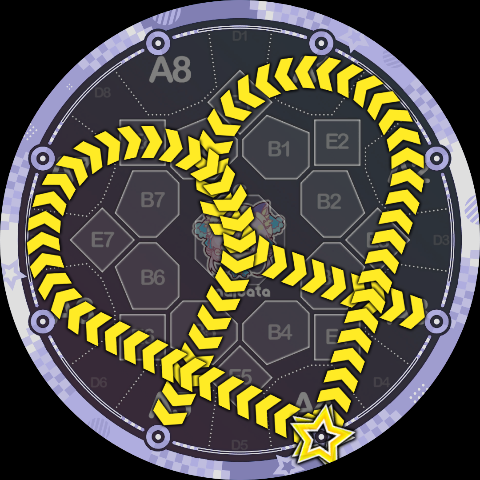
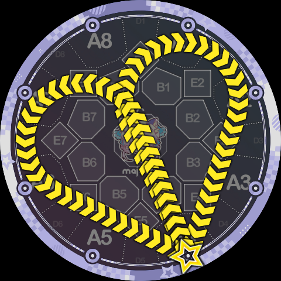
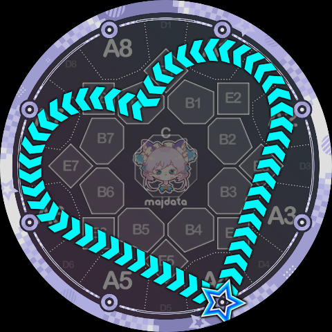
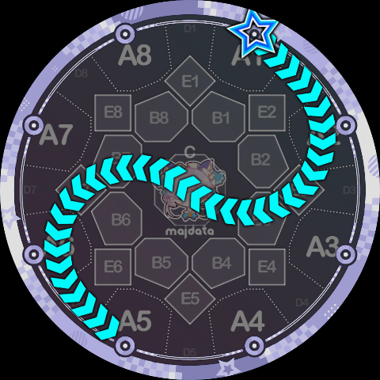

# Node and Track Connections

[Node Instructions](./nodes) and [Track Instructions](./tracks) introduce the definitions of all 6 instructions. When Slide Code is parsed, it is first expanded into a sequence of `(instruction, parameter)` pairs. Each pair of adjacent pairs defines a Slide path segment, and all segments spliced together form the complete Slide path.

In theory, any two `(instruction, parameter)` pairs can be connected freely, but considering the specific semantics, some connections are not allowed. This page covers the three connections involving nodes; for track-to-track connections see [Track-to-Track Transitions](./track-transitions).

## Node → Node

This connection is the easiest to understand, since node instructions mean "**travel in a straight line to a specified point**." When two node instructions are connected, the resulting path segment is a line segment connecting the two points. Any two node instructions can be connected. We have already seen many examples when introducing node instructions, so they will not be repeated here.

## Node → Track

When a node instruction is followed by a track instruction, the basic semantics are "**travel along a tangent into the track, then stop at the tangent point ready to begin rotating**." The specific rotation angle cannot be determined from the track instruction alone — it depends on what follows, so it will be covered in later sections.

As is well known, the relationship between a point and a circle has three cases: the point is outside the circle, on the circle, or inside the circle. When a node instruction is followed by a track instruction, these three cases also arise.

When the node is inside the track, e.g. a sequence like `B2P3`, **this connection is forbidden** because there is no reasonable connecting path.

All cases where a node is inside a track are:

- Inside the central circle (number `0`): node C.
- Inside each side circle (numbers `1~8`): two B-area nodes, e.g. track 3 contains B2 and B3.
- All B-area and C-area nodes are inside the outermost circle (number `9`), so only A-area nodes can travel to the outermost circle.

When the node is on the track, e.g. `CP3` or `A1Q9`, since it is already on the track, no tangent is needed — it stays in place and prepares to begin rotating. All such cases are:

- Node C is on all side circles.
- All A-area nodes are on the outermost circle.

The following cases may appear to be "on the track" but are actually outside it, a small distance from the circle's circumference:

- All B-area nodes are actually outside the central circle.
- The two A-area and two B-area nodes that a side circle passes through are actually outside that circle.

When the node is outside the track, the tangent point must be calculated based on the specific rotation direction of the track instruction, and the path moves along the corresponding tangent to the tangent point. The following diagram shows the connection for `A1P5`, which is easy to understand:

## Track → Node

Once on the track, how far to rotate depends on what instruction follows. When a track instruction is followed by a node instruction, the basic semantics are "**rotate to a new tangent point, then leave along the tangent toward the specified point**." Similar to Node → Track above, this can also be divided into three cases. **The case where the node is inside the track remains forbidden**, and the on-track case only requires rotation without a tangent.

For example, continuing the `A1P5` example from above, if the full segment is `A1P5A7`, then the `P5A7` part is parsed as shown below:

When calculating the rotation angle, the parser **always takes the shortest possible path and never makes an extra revolution under any circumstances**. This is why translating the official `1pp4` and `1pp5` shapes requires explicitly specifying the extra revolution. However, for cases where the rotation start and end points happen to coincide (e.g. the official `8p5`), a full 360° revolution is made. In summary, when no extra revolution is explicitly specified, **the rotation angle is always in the range `(0°, 360°]`** (there is one exception in [Track-to-Track Transitions](./track-transitions)).

Using the above three connection types, we can already analyze much Slide Code. For example, if the above example is a complete Slide, it is written as `1P5K7`:

As another example, the reverse ppqq-Slide shown in the [Overview](./index) can be obtained by translating the forward ppqq into Slide Code and then writing it backward. For example, the reverse of `5pp4/3qq4` is obtained by first translating to `5P7K4/3Q2K4`, then reversing each to `4Q7K5/4P2K3`. Of course, since it becomes a same-head Slide, the final form using same-head Slide syntax is `4Q7K5 *P2K3`:

Another example is `4Q2K4 *P7K4`:

The following is `4P2B8P7K4`, using the B8 area as a transfer point between two side circles:

The following is `1Q2CP6K5`, using the C area as a transfer point. Since the two circles happen to be tangent at the center of the screen, the transition looks very smooth:

