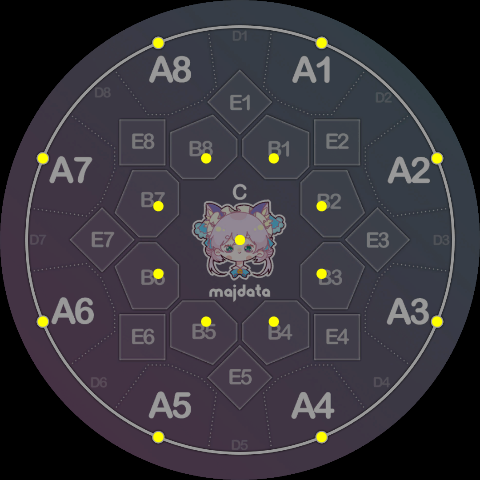
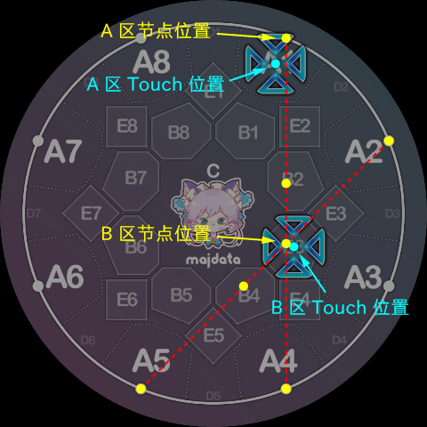
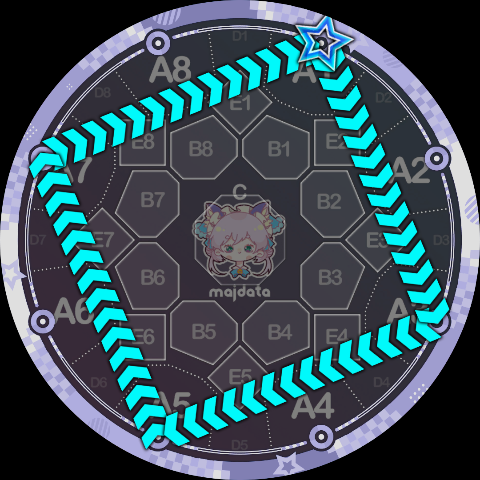
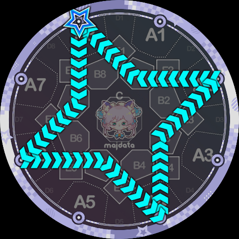
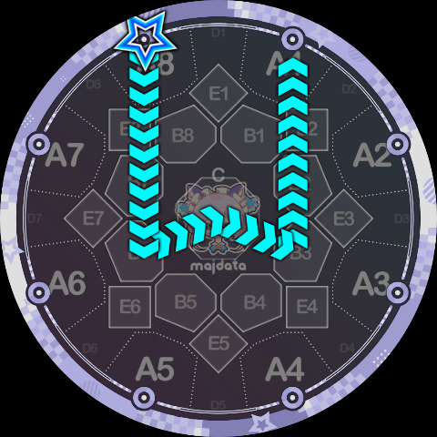

# Node Instructions

These instructions require the Slide to **travel in a straight line to a specified judgment-area position**. Together with the parameter that follows, they are simply the name of the target judgment area, e.g. `A1, B3, C, B8`.

Players familiar with Maimai should know that official Slide judgment only checks the A, B, and C areas — D and E areas are not considered. Therefore, to ensure that Slides defined by Slide Code can produce reasonable judgment queues, **Slide Code only includes instructions corresponding to the A, B, and C areas**:

* **A instruction**: travel in a straight line to the A area. Parameter is `1~8`, indicating the specific A-area key number.
  * Note: the target point is not at the Touch position, but on the **judgment line**, allowing travel to adjacent positions.
* **B instruction**: travel in a straight line to the B area. Parameter is `1~8`, indicating the specific B-area key number.
  * Note: the target point is not at the Touch position, but slightly toward the center of the screen (consider the intersection of `1-4` and `2-5`, which is not at the `B3` Touch position).
* **C instruction**: travel in a straight line to the C area (exact center of the screen). **This instruction must not be followed by any parameter.**

The positions of these 17 nodes are shown below:

Note the differences from the corresponding Touch positions:

The reason for introducing these positional differences is to maximize the reuse of official Slide shapes, which to some extent makes the resulting Slides look more aesthetically pleasing.

In particular, **since official Slides always end in the A area**, Slide Code (currently) preserves this property. We use a special instruction to mark the end of the Slide:

- **K instruction**: marks the endpoint of the Slide. Its visual behavior is identical to the A instruction, but it marks the end of the entire Slide for judgment purposes. **A Slide Code must end with a K instruction and its parameter.** Parameter is `1~8`, indicating the specific A-area key number.

> The reason for using the letter K is actually a pun. A straightforward explanation is "Key" — since the outer keys are outside the screen, traveling to an outer key means "leaving the inner screen," and thus the Slide is over.
> Additionally, as some may know, Minepig is a deep enthusiast of music theory, so the second interpretation of K is the literal meaning of "Cadence" (German: Kadenz), referencing the cadential six-four chord $\mathrm{K}^6_4$ in music theory.

Technically, we sometimes treat the Slide's starting point as a separate node instruction, but this instruction does not actually appear in the Slide Code string:

- **X instruction**: represents the starting point of the Slide. **The letter `X` must be omitted in Slide Code; just write the digit alone, like the traditional Slide syntax `1-4`.** Parameter is `1~8`, corresponding to the eight starting points on the judgment line, which are the same positions as the A instruction nodes.

With the above four instructions we can already write the following simple polyline Slides:

`1B7K5`, i.e. starting from key 1, turning at B7, ending at key 5 — looks a lot like `1p5`.

`1A3A5A7K1` is basically the Slide Code way of writing `1-3-5-7-1`.

`8B7A6B5A4B3A2B1K8` is a four-pointed star.

`8B6CB3K1` looks like a small W.

