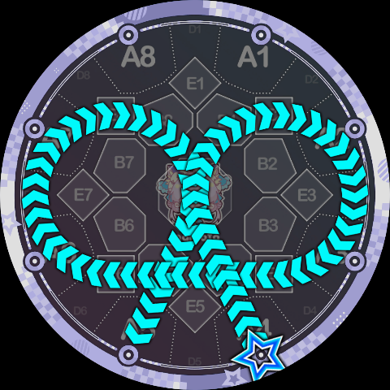
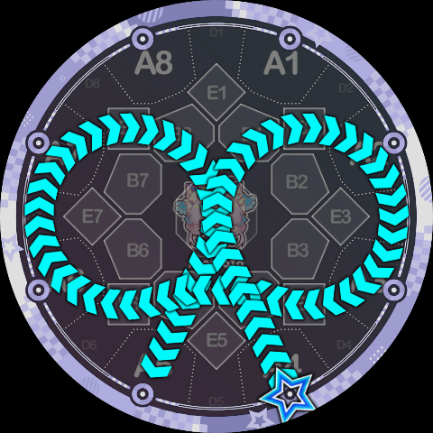
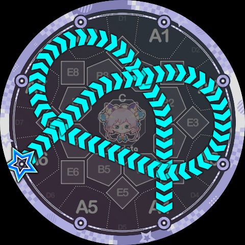
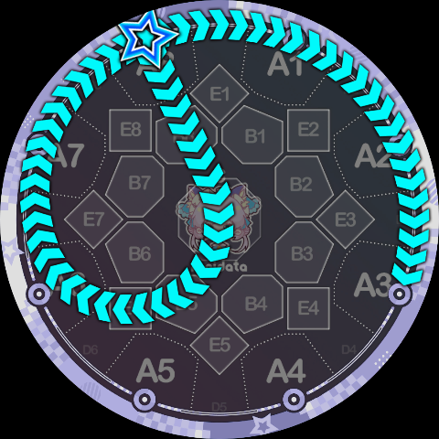
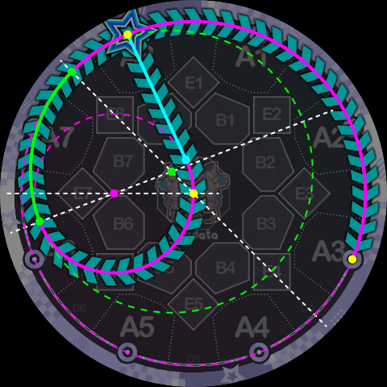
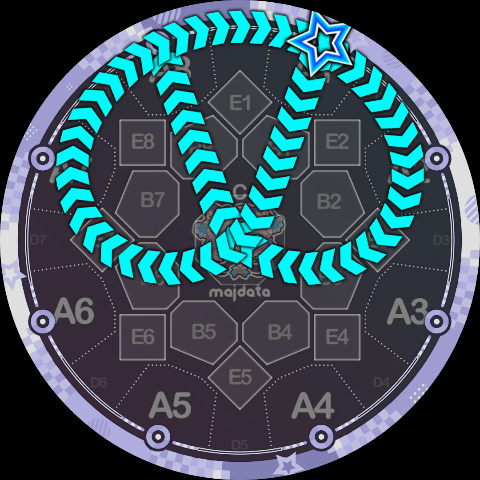
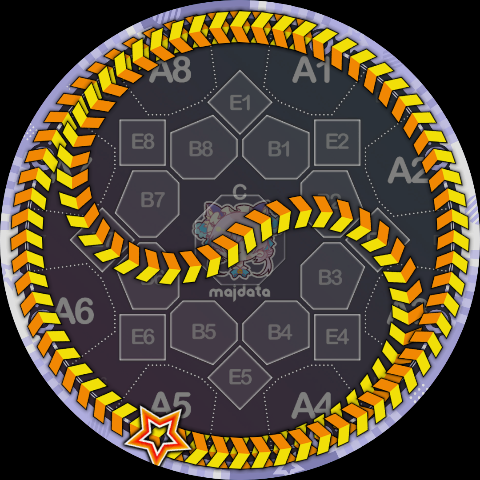

# Track-to-Track Transitions

When a track instruction is followed by another track instruction, **only same-direction connections are allowed** — P can only connect to P, Q can only connect to Q. If P and Q need to be connected, a node instruction must be inserted between them as an intermediary.

For the special case of two identical tracks, e.g. `P1P1` (or shorthand `P11`), as previously introduced, the meaning is to go one complete revolution around this track, used to explicitly specify the number of revolutions.

When two different tracks are used, the meaning is a track transfer. Between any two of the 10 tracks, all transfers are allowed **except between the central circle and the outermost circle** (i.e. `P09` and `Q90` are not allowed).

**Between the central circle and the 8 side circles** (i.e. between tracks 0~8), **track transfers are accomplished via an external common tangent**. Two circles have two external common tangents, and the parser automatically selects the correct one based on the current rotation direction. Let's demonstrate directly with an example: the trajectory below is written as `4Q37K5`, which includes a track transfer from circle 3 to circle 7 — an external common tangent:

For comparison, if you "take it for granted" and use the two B areas it passes through — B4 and B5 — as transfer nodes, the resulting `4Q3B45Q7K5` looks like this. Note the kink in the middle — the two do not look the same:

Here is another example using the central circle, `6Q0380K4`, which looks a bit like a trefoil knot:

Next, transfers between side circles and the outermost circle (i.e. between tracks 1~8 and track 9). Since **side circles are internally contained by the outermost circle with no common tangent, a specific common tangent circle is used as the transfer path**. Again, let's look directly at an example: `8Q79K3`, which visually resembles `8qq7>3` but with smoother transitions:

We can label each segment of the path more specifically:

In the diagram above, the green arc is the track-transfer portion of `Q79`. It is part of the green dashed circle, which is the common tangent circle of the outermost circle and side circle 7. The tangent point of this common tangent circle with the outermost circle happens to be the center of the D8 area. Therefore, a second track transfer from the outermost circle to side circle 1 can complete the remaining part of this common tangent circle. As shown below, this is `1Q892K8`, where the A7 A8 A1 A2 segment is actually a continuous arc:

Some may notice that in the `1Q892K8` above, the rotation angle of the `Q9` instruction is actually 0°, because the transfer endpoint of `Q89` and the transfer start point of `Q92` are actually the same tangent point. In fact, this is a special case deliberately left by the Slide Code parser, because the common tangent circle for this transfer has a sufficiently large radius — the arc from A8 to A1 in the diagram is visually almost on the judgment line, so a 0° rotation angle is allowed in this case.

We are now ready to analyze the yin-yang fish Slide shown below in Slide Code form: `5P98CQ49K1`

