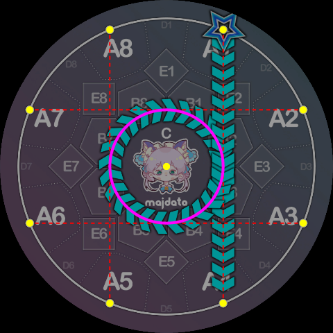
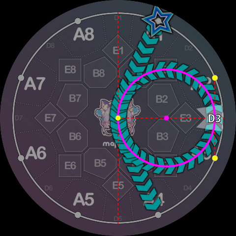
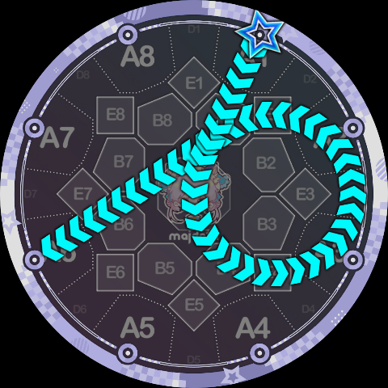
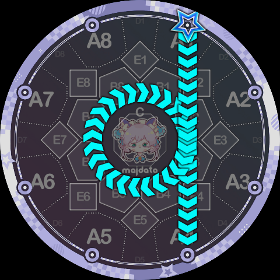
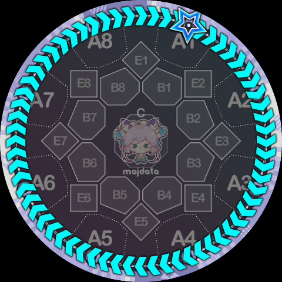
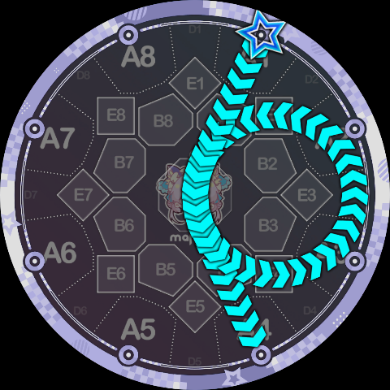
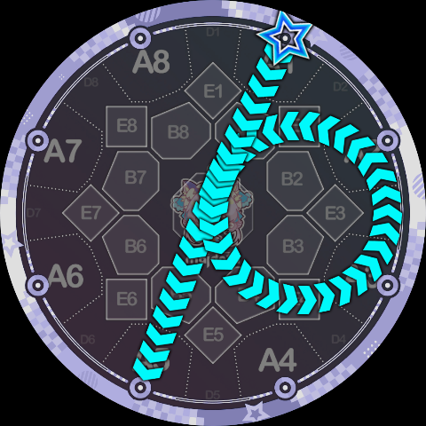
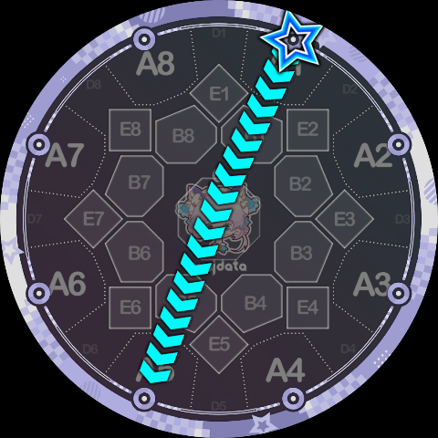

# Track Instructions

These instructions require the Slide to **rotate along a specific circular track**. If the path's starting point is outside the circle, it first travels along a tangent to enter the circle before rotating; when leaving the track to go elsewhere, it rotates to a suitable angle before leaving along a tangent.

Among the official Slide shapes, there are 10 different circles. In Slide Code each is assigned a number from `0~9`:

* Side circles: the circles traversed by ppqq-Slides in the standard syntax, 8 in total. For convenience, the side circle's number matches the D-area key number it passes through, ranging from `1~8`. (For example, the circle traversed by the standard syntax `1pp4` passes through D3, so it is circle 3.)
* Central circle: the circle traversed by pq-Slides in the standard syntax. It does not pass through any D area, so it is assigned the number `0`.
* Outermost circle: the circle traversed by `<` and `>` Slides in the standard syntax, i.e. the judgment line itself. It passes through all D areas, so it is assigned the largest number `9` (the only remaining number).

The specific definition of the central circle is shown below:

The definition of a side circle (circle 3 is shown):

The outermost circle is simply the judgment line itself, and needs no further explanation.

Rotation can be clockwise or counterclockwise. Slide Code borrows the `p, q` notation from standard simai and defines the following two track instructions:

* **P instruction**: rotate **counterclockwise** around the specified circle. Parameter is `0~9`, indicating the specific circle number.
* **Q instruction**: rotate **clockwise** around the specified circle. Parameter is `0~9`, indicating the specific circle number.

Using these two track instructions, we can translate official Slide shapes into Slide Code:

`1pp6 = 1P3K6`, i.e. starting from key 1, rotating counterclockwise around circle 3, then ending at key 6.

`1q4 = 1Q0K4`, here it happens to rotate exactly 360°.

`1>1 = 1Q9K1`, again exactly 360°.

Note that the official `1pp4` and `1pp5` are special because the central angle they traverse exceeds 360°. In this case, Slide Code requires the track instruction to be repeated to indicate "one extra revolution":

`1pp4 = 1P3P3K4`, the repeated `P3` means to go around circle 3 one extra time.

`1pp5 = 1P3P3K5`, if you look back at the side circle shape definition, you should be able to understand why this exceeds 360° rather than being exactly 360°.

Of course, this means you can intentionally not go the extra revolution, for example:

`1P3K5` looks a lot like `1-5` but is not `1-5` (note the trajectory curves slightly to the left).

`1P3K4` looks a lot like `1v4` but is not `1v4`.

Since you can request one extra revolution, you can of course go around many more times, e.g. `1P0P0P0P0P0K8` goes around a total of 4.75 times:

