# 見た目のデザインのヒント

ここまで読んできた方なら、スライドコードがもたらす大きな自由度を感じ取れたはずです。実際、スライドコードは自由度が非常に高いからこそ、扱いやすい構文ではありません。思いつきで使うと、たいていは唐突で醜く、しかも面白くないものになります。以下では、見た目とプレイアビリティの 2 つの観点から、いくつかの使用上のヒントを述べます。

スライドコードを、公式のスライドを主体とした譜面にうまく溶け込ませるには、まずはスライド自体を「公式のスライドのように見える」ようにすることが大切です。ここでは（Minepig が）悪くないと考えるいくつかの例を挙げます。まずは折れ線スライドの例です。

- `8B7K6[8:1]/1B3K5[8:1]`。ここでは `1B3K5` を標準構文の `1q5` に置き換えることもできます。標準のスライドにおける `1-4/8-5` の見慣れた印象を利用しています。

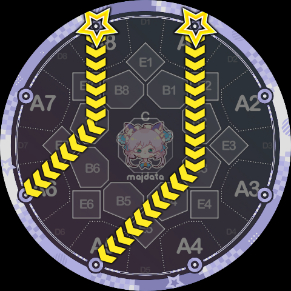

- `5B7K3[4:1]*-8-2[4:1]`。「F」の字のような文字押しです。公式の `5-8-2` があることで、`5B7K3` がずっと自然に見えます。

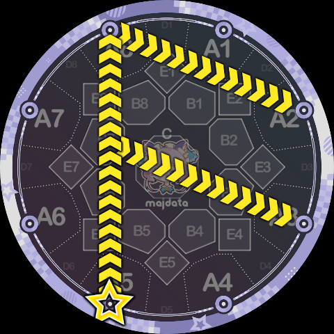

- `7-3[8:1]/1B3K5[8:1]`。これは……飛行機に見えますか？ ここでは `7-3` を使って `1B3K5` の B3 の折れ点を覆っています。C エリアにない折れ点はスライドを醜く見せる原因の 1 つになりがちなので、覆ってしまえば見栄えがかなり良くなります（しかも構図のバランスも良くなります）。

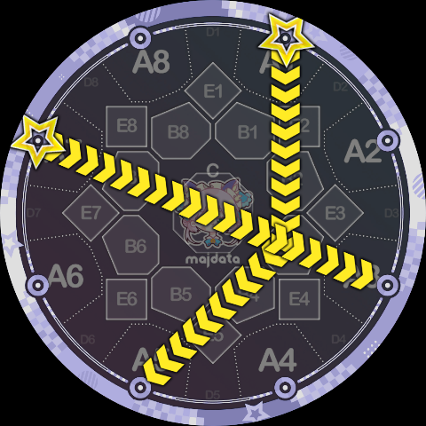

次に、トラック命令を使った曲線スライドです。曲線スライドを公式のスライドに「擬態」させたい場合、最も簡単な方法はトラックを 1 つだけ使うことです。`PK/QK` のような定石を使い、`1P4K7` のような ppqq スライド風のものを描きます。公式の ppqq スライドは、最初に C エリアへ向かってから周回を始め、周回後に離脱する線分は周回前に進入する線分より少し長いことが多いため、スライドコードもこの方向に寄せるとよいでしょう。いくつか例を見てみます。

- `1P4K7[4:1]`、なかなかそれらしく見えませんか？ 実際にはこれはどの ppqq スライドの逆方向でもなく、単に `1pp7` に見えるだけです。ただし本来の `1pp7` は 3 番円を周回しますが、こちらは 4 番円を使っています。

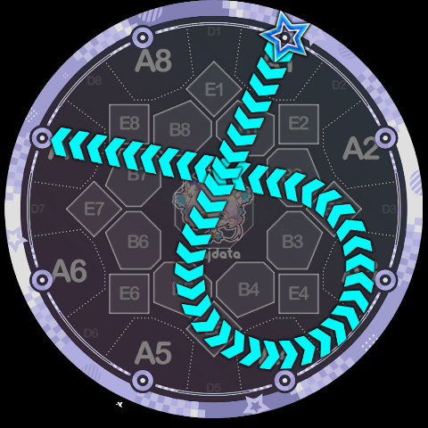

- この `1P5K8[4:1]` はやや見慣れない印象です。5 番円へ入る接線が C エリアから少し離れているためです。ただしパスが対称なので、その点も美しさを高めます。

- 次の `1P2K8` のようなものは、比較的見栄えがよくありません。公式の `1pp8` にいくらか似てはいますが、重心が明らかに片側に寄っており、「歪んで」見えます。ただし救う方法はあります。次のテクニックを参照してください。

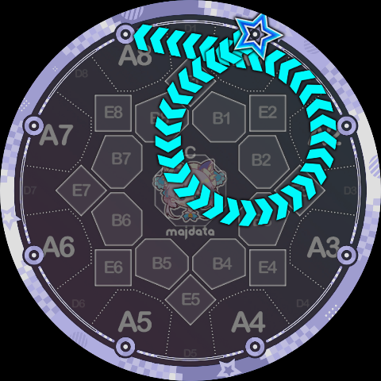

美しさを高める方法の 1 つは、複数スライドの配置で軸対称または回転対称の形を描くことです。公式の譜面にも `1pp3[4:1]/5pp4[4:1]` のような配置があります。こうすれば、単体のスライドが多少「ずれて」見えても、ペアになると見栄えがずっと良くなります。いくつか例を挙げます。

- `1P2K8[4:1]/5P6K4b[4:1]`。筆者はこの配置が、先ほどの `1P2K8` 単体よりもはるかに目に優しいと感じています。

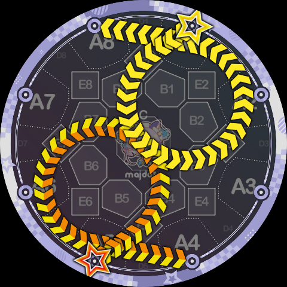

- もう 1 つの例：`1Q4K7[4:1]/5Q8K3[4:1]`。単体ではあまり良く見えず、公式のスライドとの差も大きいですが、回転対称のペアにするとむしろなかなか良い感じになります。

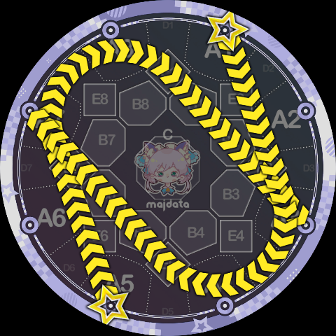

- 軸対称の例：`6P6K8[4:1]/3Q4K1[4:1]`。公式の `3V58/6V41` と同様の使い方です。

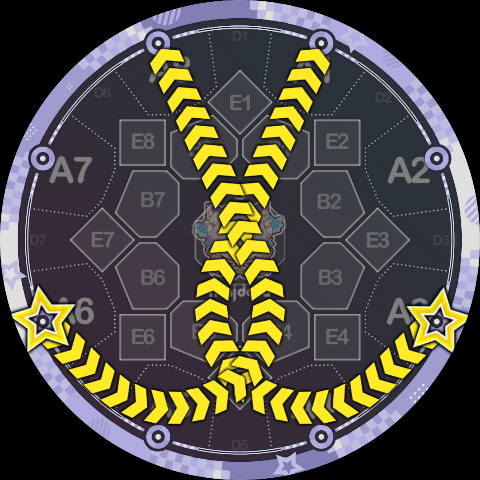

複数のトラックを使うスライドの場合、公式のスライドへの「擬態」はほぼ不可能なので、こうしたスライドの作図には譜面作者の個人的な美意識と美術的な能力が必要になります。通常はやはり対称性などの形式美の規則に従うか、あるいはさまざまな文字押し・図形押しを利用して、スライドが浮いて見えないようにします。いくつか例を挙げます。

- [トラック間の遷移](./track-transitions) で紹介した陰陽魚スライド `5P98CQ49K1`。ここでは図を再掲しません。
- 小文字 f の文字押し、`1P2CQ6K5[8:1]/6-2[8:1]`。この図形の着想は、公式譜面『Override』の 260 combo 地点にある「関数押し」から来ています。面白いことに、この図形を反転させると小文字の x やヘブライ文字の Aleph（א）の文字押しになります。

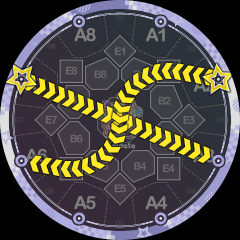

- `8Q87A6Q6K4[1:1]*P12A2P3K4[1:1]`、これは……クローバー？ いずれにせよ面白い図形です。

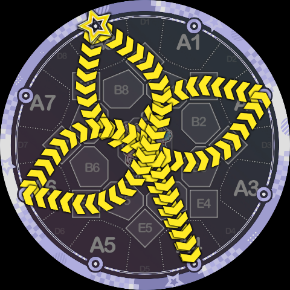

- `8P97B4Q0K1b[1:1]/4P93B8Q0K5[1:1]`、意味不明な複数スライドで、純粋に回転対称性だけで美しさを出しています。螺旋丸を練っているようにも感じますね？

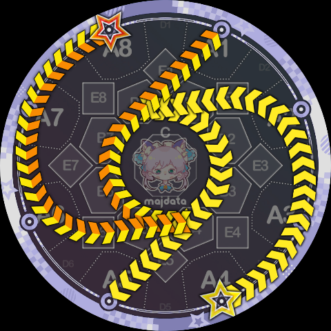

**次に反面教師の例です。以下の例について、Minepig の見解は「醜い」です。**

- `1P15K4`（青）、`1Q8CP4K5`（絶賛）、`1P8K7`（黄）、意味不明なカーブです。どうしてもこの形状を使わなければならない理由がない限り、おとなしく公式の `1-4`、`1-5`、`1^7` または `1-7` で置き換えることをおすすめします。同様に、`1Q3K4` は `1^4` で、`1Q34K5` は `1>5` で置き換えるとよいでしょう。

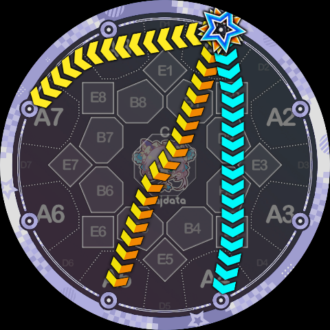

- `1P43K5`、この「カプセル形」の ppqq もどきスライドは、通常の ppqq スライドより明らかに美しさが劣ります。単体で見ると非常に唐突なので、使う場合は他の図形と組み合わせることを検討してください。

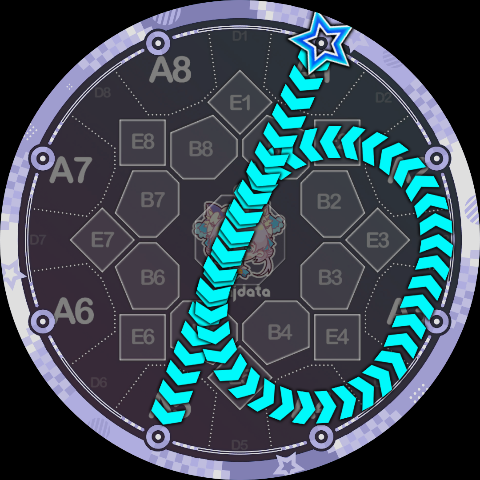

- `1P04K2`、うまく言い表せない違和感があります。この形状と上の「カプセル」は実際には同じ種類の問題で、移行トラックを描くときに元の円軌道をできるだけ描き出していない、あるいは構図の取り方がうまくなく、「2 つの円弧 + 共通接線」に見えず「奇妙な曲線 1 本」に見えてしまうことが原因です。実際、この例は対称な `5P08K6` をもう 1 本追加するだけで見栄えがかなり良くなります（万能の回転対称）。理由の 1 つは、2 本のスライドの軌道が合わさって中央円を描き出すことです。

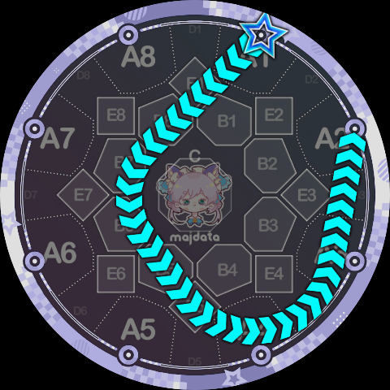

総じて、スライドコードで美しいスライドを描くのは非常に難しい課題であり、主観性も強いです。時には、醜いスライドがかえって曲の雰囲気（狂気、おふざけなど）を思いがけず表現できることもあります。紙幅も限られているためすべてを網羅することはできません。譜面作者は実践の中で少しずつ試していく必要があります。
