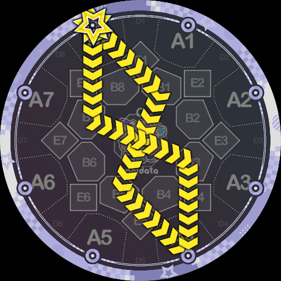
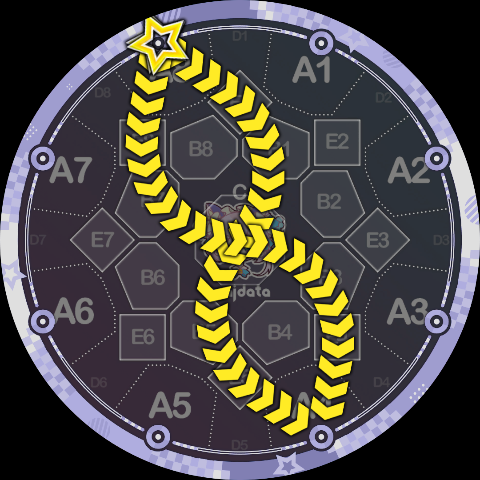
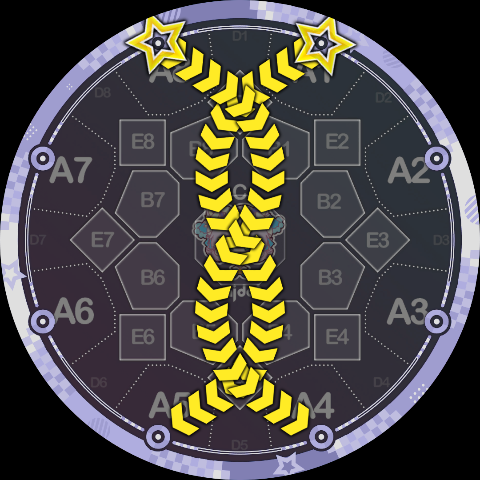
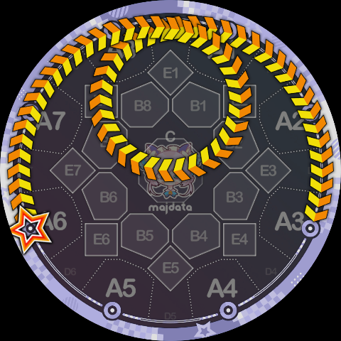
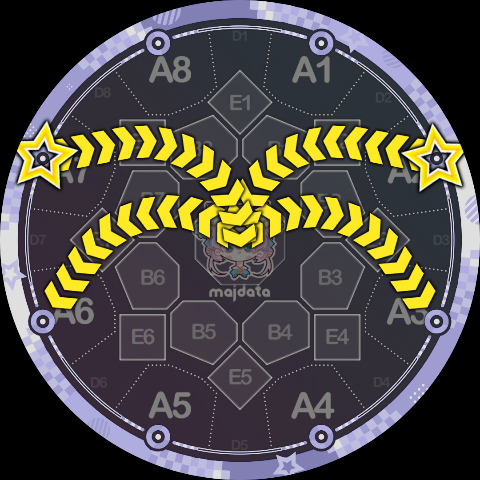
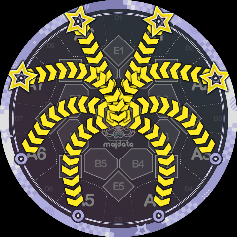
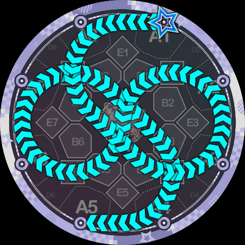

# 例

上ですでに多くの作例画像を挙げてきましたが、スライドコードの可能性はほぼ無限です。以下に、さまざまな出典から集めたスライドコードの配置を参考用に掲載します。

`8B7B3K4[8:1]*B1B5K4[8:1]`

`8P1CQ5K4[8:1]*Q8CP4K4[8:1]`

`8Q8CP4K4[8:1]/1P2CQ6K5[8:1]`

`6Q919K3b[1:1]`

`7Q7CP6K6[8:1]/2P3CQ4K3[8:1]`（……カラスが飛ぶ？）

`7Q7CP6K6[1:1]/2P3CQ4K3[1:1]/8Q7CP5K5[1:1]/1P3CQ5K4[1:1]`（多押しになっていますが、このクモは本当にかっこいいですよね？）

`1P13CQ75K5[1:2]`

（作例はまだ続きます……）
