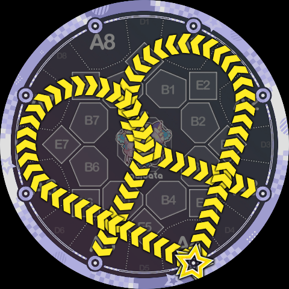
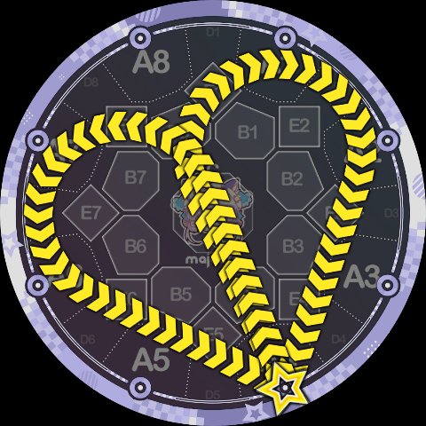
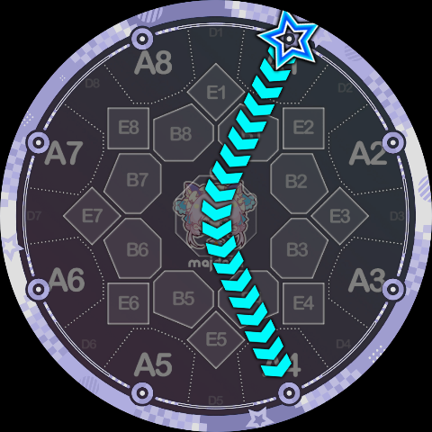
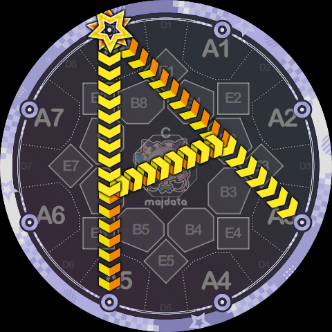
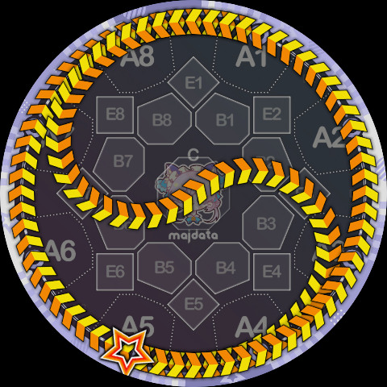
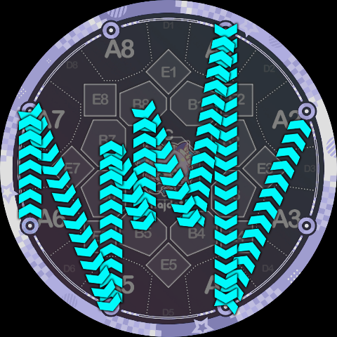

# スライドコードの概要

スライドコードは Minepig が考案した新しいスライド構文です。複雑なスライドの軌道を短い文字列で表すことができ、例えば `5Q9A1P98CQ49K5` のように書きます。最も初期のスライドコードのデモ動画は [Believe in Rainbow, but maimai DX 2077](https://www.bilibili.com/video/BV1Uu42eqEWF/) です。MajdataViewX はバージョン 6.1.0 からスライドコードの記述に対応しています。

## 読み進め方

- [ノード命令](./nodes)
- [トラック命令](./tracks)
- [展開と Simai 互換性](./shorthand)
- [ノードとトラックの接続](./node-paths)
- [トラック間の遷移](./track-transitions)
- [判定キュー](./judgment)
- [見た目のデザインのヒント](./appearance)
- [プレイアビリティのデザインのヒント](./playability)
- [例](./examples)

## 設計理念

スライドコードの設計理念は、基本的には「公式のスライド形状を小さな断片に切り分け、それらを継ぎ合わせて新しいスライドの軌道を作る」というものです。maimai に詳しく、細部まで注意を払うプレイヤーなら、**公式のスライドはほぼ直線と円弧の固定された組み合わせと見なせる**ことにお気づきでしょう。スライドコードは、こうした線分・接線・円弧を接合用の部品として組み合わせて使います。

スライドコードの構文に含まれる文字は、次の 2 種類だけです。

* **命令**：大文字の `A, B, C, K, P, Q`
* **パラメータ**：数字の `0~9`

1 つのスライドコードは、省略表記された `(instruction, parameter)` の組の並びと見なせます。これらの組が順に並び、パスの断片を 1 つずつ記述します。命令の意味に応じて、次の 2 グループに分けられます。ノード命令 `A, B, C, K`（特定の点へ移動）と、トラック命令 `P, Q`（特定の円に沿って回転）です。

## 作例

スライドコードを使うと、従来の構文では書けない次のようなスライドを描けます。

逆方向の ppqq スライド：

より大きなハート形のスライド：

片手のハート：

`1v4` によく似ていますが `1v4` ではない円弧スライド：

`1p5` によく似ていますが `1p5` ではない折れ線スライド：

更新されたものの、必ずしも人気とは限らない文字押し：

陰陽魚：

その他の名状しがたいもの：

