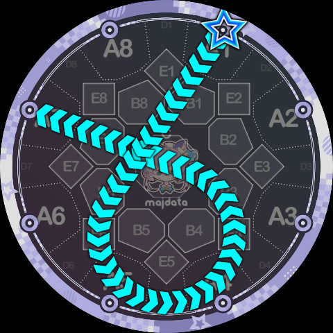
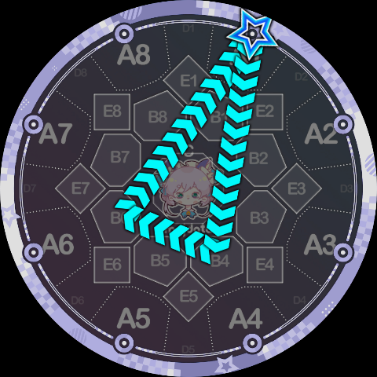
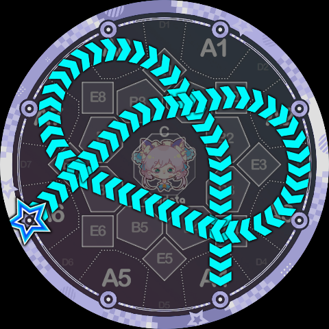
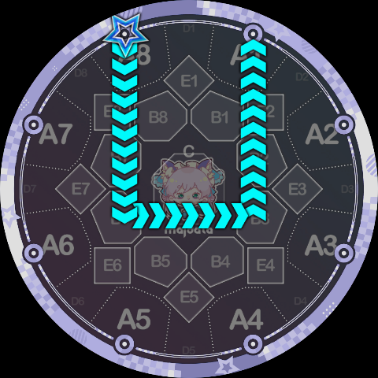
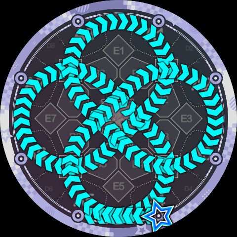

# 判定キュー

スライドコードを使った譜面を実際の筐体でプレイできるようにするには、スライドコード用の判定キューを用意する必要があります。幸いなことに、スライドコードは最初から「公式のスライドを切り分けて継ぎ合わせる」という理念で設計されているため、その判定キューも継ぎ合わせによって比較的簡単に得られます。

[トラック間の遷移](./track-transitions) の陰陽魚スライドを例にすると、その判定キューは自然に `A5, A4, A3, A2, A1, A8, A7, B6, C, B2, A3, A4, A5, A6, A7, A8, A1` と書けます。

もう 1 つの例として、次の `1P5K7` は明らかに `3pp7` と `6qq1` の判定キューを継ぎ合わせて得られ、`A1 B1/B8, B7/C, B6, A5, A4, B3, C, B7, A7` になります。

ただし、スライドコードには公式のスライドに存在しない形状もいくつかあります。例えば次の三角形のスライド `1B46K1` では、A1 から B4 までと B6 から A1 までの線分は `1pp6` のような ppqq スライドの末尾の判定キューから取り出せますが、B4 から B6 までは完全に新しいものです。このスライドの判定キューは最終的に `A1, B1/B2, B3/C, B4, B5/C, B6, B7/C, B1/B8, A1` と定められました。

つまり、1 つ分のキーを挟んだ 2 つの B エリアの位置を結ぶ線には、その間に B エリアと C エリアからなる OR 判定エリアが入ります。同様に、次の `6Q0380K4` の判定キューは `A6, B7, B8, B1, A2, A3, B4, B5/C, B6, A7, A8, B1, B2, B3, A4` です。

さらに、2 つ分のキーを挟んだ B エリア同士を結ぶ線で、その間に 2 つの OR 判定エリアが入る場合もあります。`8B63K1` の判定キューは `A8, B7, B6, B5/C, B4/C, B3, B2, A1` です。

サイド円の移行経路にも同様の、2 つ分のキーを挟んだ B エリア同士を結ぶ線が存在します。例えば次の `4Q53175K5` の判定キューは `A4, A5, B6, B7/C, B8/C, B1, A2, A3, B4, B5/C, B6/C, B7, A8, A1, B2, B3/C, B4/C, B5, A6, A7, B8, B1/C, B2/C, B3, A4, A5` です。

