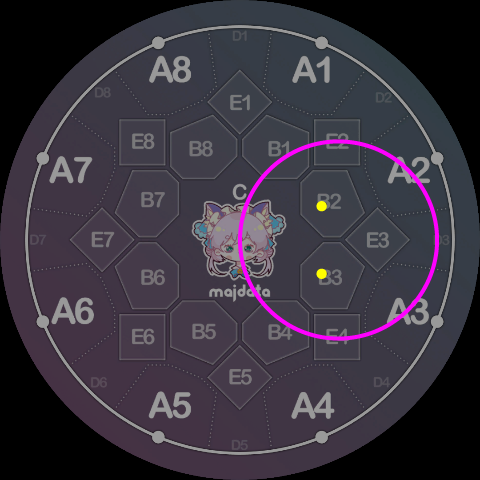
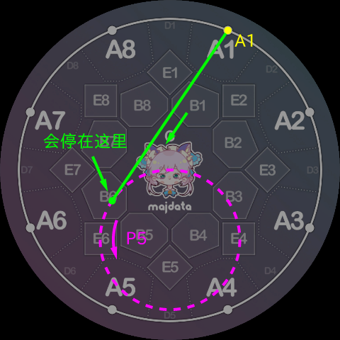
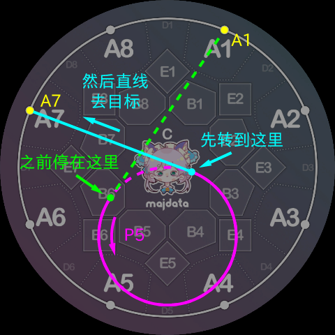
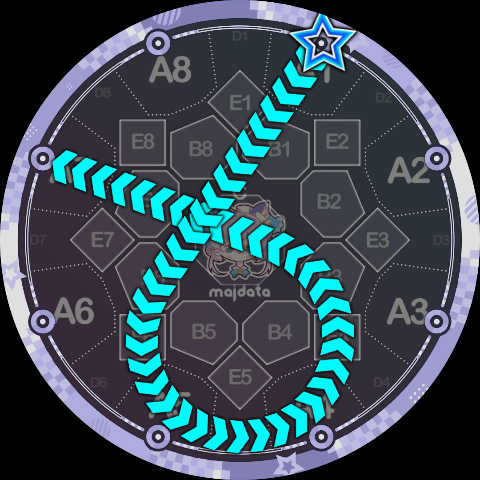
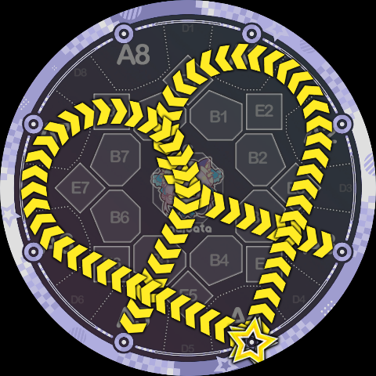
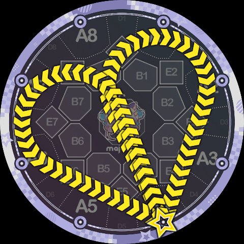
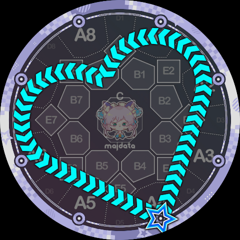
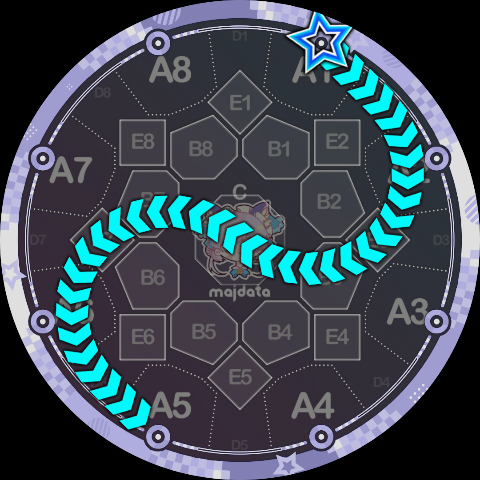

# ノードとトラックの接続

[ノード命令](./nodes) と [トラック命令](./tracks) で、6 種類すべての命令の定義を紹介しました。スライドコードは解析時に、まず `(instruction, parameter)` の組の列に展開されます。隣り合う 2 つの組が 1 つのスライドのパス断片を定義し、すべての断片を継ぎ合わせることで完全なスライドの軌道になります。

理論上は、任意の 2 つの `(instruction, parameter)` の組を自由に接続できますが、具体的な意味を考えると、許可されない接続もあります。このページではノードが関わる 3 種類の接続を扱います。トラック同士の接続については[トラック間の遷移](./track-transitions)を参照してください。

## ノード → ノード

この接続は最も分かりやすいものです。ノード命令は「**指定した点へ直線で移動する**」という意味だからです。2 つのノード命令を接続すると、得られるパス断片は 2 点を結ぶ線分になります。ノード命令はどの 2 つでも接続できます。ノード命令の紹介で既に多くの例を見てきたので、ここでは繰り返しません。

## ノード → トラック

ノード命令の後にトラック命令が続く場合、基本的な意味は「**接線に沿ってトラックへ入り、接点で停止して回転を始める準備をする**」ということです。具体的な回転角度はトラック命令だけでは決まらず、その後に何が続くかによって決まるため、後の節で扱います。

よく知られているように、点と円の位置関係には、点が円の外側にある、円上にある、円の内側にあるという 3 つの場合があります。ノード命令の後にトラック命令が続く場合にも、この 3 つの場合が生じます。

ノードがトラックの内側にある場合、例えば `B2P3` のような並びでは、**この接続は禁止されています**。合理的な接続経路が存在しないためです。

ノードがトラックの内側にある場合は、次のとおりです。

- 中央円（番号 `0`）の内側：ノード C。
- 各サイド円（番号 `1~8`）の内側：2 つの B エリアノード。例えばトラック 3 の内側には B2 と B3 があります。
- B エリアと C エリアのノードはすべて最外周円（番号 `9`）の内側にあるため、最外周円へ移動できるのは A エリアのノードだけです。

ノードがトラック上にある場合、例えば `CP3` や `A1Q9` では、すでにトラック上にあるため接線を通る必要はなく、その場にとどまって回転を始める準備をします。該当する場合は次のとおりです。

- ノード C はすべてのサイド円上にあります。
- A エリアのノードはすべて最外周円上にあります。

次の場合は「トラック上」に見えるかもしれませんが、実際にはトラックの外側にあり、円周から少し離れています。

- B エリアのノードは、実際にはすべて中央円の外側にあります。
- サイド円が通過する 2 つの A エリアノードと 2 つの B エリアノードは、実際にはその円の外側にあります。

ノードがトラックの外側にある場合は、トラック命令の具体的な回転方向に基づいて接点を計算し、対応する向きの接線に沿って接点まで移動します。次の図は `A1P5` の接続を示しており、理解しやすいでしょう。

## トラック → ノード

トラック上に来た後、どれだけ回転するかは、その後に続く命令によって決まります。トラック命令の後にノード命令が続く場合、基本的な意味は「**新しい接点まで回転し、接線に沿って離脱して指定した点へ向かう**」ということです。前述のノード → トラックと同様に、これも 3 つの場合に分けられます。**ノードがトラックの内側にある場合は引き続き禁止**であり、トラック上にある場合は接線を通らずに回転するだけで済みます。

例えば、前述の `A1P5` の例を続けると、断片全体が `A1P5A7` である場合、`P5A7` の部分は次の図のように解析されます。

回転角度を計算するとき、パーサーは**常に最短の経路を取り、いかなる場合も追加の 1 周を行いません**。これが、公式の `1pp4` と `1pp5` の形状を変換する際に、追加の 1 周を明示する必要がある理由です。ただし、回転の始点と終点がたまたま一致する場合（例えば公式の `8p5`）は、360° の 1 周全体を回転します。まとめると、追加の周回を明示しない場合、**回転角度は常に `(0°, 360°]` の範囲内**になります（[トラック間の遷移](./track-transitions)に 1 つだけ例外があります）。

以上の 3 種類の接続を使えば、多くのスライドコードをすでに解析できます。例えば前述の例が完全な 1 本のスライドであれば、`1P5K7` と書けます。

もう 1 つの例として、[概要](./index) で示した逆方向の ppqq スライドは、正方向の ppqq をスライドコードに変換してから逆順に書くことで得られます。例えば `5pp4/3qq4` の逆方向は、まず `5P7K4/3Q2K4` に変換し、それぞれを反転して `4Q7K5/4P2K3` とします。もちろん、同頭スライドになるため、同頭スライドの構文を使った最終形は `4Q7K5 *P2K3` になります。

もう 1 つの例は `4Q2K4 *P7K4` です。

次は `4P2B8P7K4` です。B8 エリアを 2 つのサイド円の中継点として使用しています。

次は `1Q2CP6K5` です。C エリアを中継点として使用しています。2 つの円がちょうど画面中心で接しているため、つながりが非常に滑らかに見えます。

