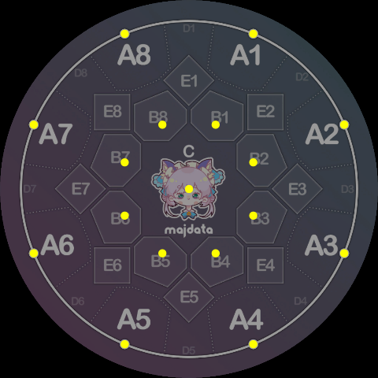
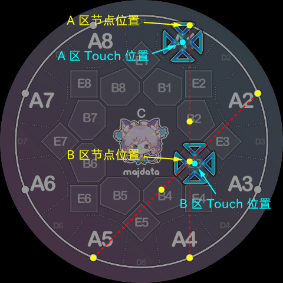
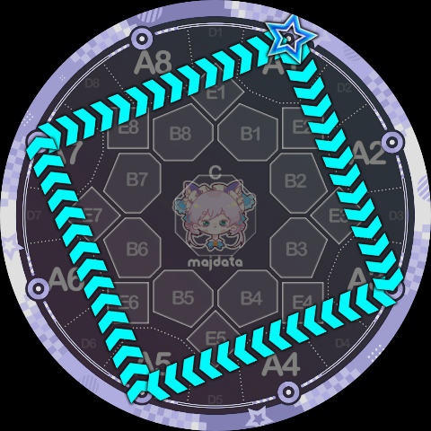
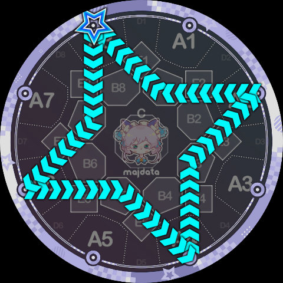
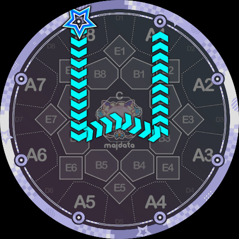

# ノード命令

これらの命令は、スライドが**指定された判定エリアの位置まで直線で移動する**ことを要求します。そのため、命令とその後ろに続くパラメータは、そのまま目標となる判定エリアの名前になります（例：`A1, B3, C, B8`）。

maimai に慣れたプレイヤーならご存じのとおり、公式のスライド判定は A・B・C エリアのみを見ており、D・E エリアは考慮されません。そのため、スライドコードで定義したスライドから合理的な判定キューを生成できるよう、**スライドコードには A・B・C エリアに対応する命令だけを含めています**。

* **A 命令**：A エリアへ直線で移動します。パラメータは `1~8` で、A エリアの具体的なキー番号を表します。
  * 注意：目標点はタッチの位置ではなく、**判定線上**にあります。そのため隣接する位置へ移動できます。
* **B 命令**：B エリアへ直線で移動します。パラメータは `1~8` で、B エリアの具体的なキー番号を表します。
  * 注意：目標点はタッチの位置ではなく、画面中心側に少しずれた位置にあります（`1-4` と `2-5` の交点を考えてみてください。それは `B3` のタッチ位置にはありません）。
* **C 命令**：C エリア（画面の正中心）へ直線で移動します。**この命令の後にパラメータを続けてはいけません。**

これらの 17 個のノードの位置は次の図のとおりです。

対応するタッチ位置との違いに注意してください。

上のような位置の違いを設けているのは、公式のスライド形状を最大限に流用するためです。これにより、組み合わせて作ったスライドがある程度見栄えよく見えるようになります。

特に、**公式のスライドは常に A エリアで終わる**ため、スライドコードも（現時点では）この性質を保っています。スライドの終了を示すために、専用の命令を用意しています。

- **K 命令**：スライドの終点を表します。視覚的な挙動は A 命令とまったく同じですが、判定上はスライド全体の終了を示します。**スライドコードは必ず K 命令とそのパラメータで終わらなければなりません。** パラメータは `1~8` で、A エリアの具体的なキー番号を表します。

> K という文字を使っている理由は、実は駄洒落です。素直な解釈は「Key（キー）」で、外側のキーは画面の外側にあるため、外側のキーへ移動することは「内側の画面から離れる」こと、つまりスライドの終了を意味します。
> また、ご存じの方もいるかもしれませんが、Minepig は音楽理論の熱心な愛好家なので、K の 2 つ目の解釈は「Cadence（終止、ドイツ語で Kadenz）」という文字どおりの意味です。音楽理論における終止四六和音 $\mathrm{K}^6_4$ にちなんでいます。

技術的には、スライドの始点も独立したノード命令として扱うことがありますが、この命令がスライドコードの文字列に実際に現れることはありません。

- **X 命令**：スライドの始点を表します。**ただしスライドコードでは文字 `X` を省略し、従来のスライド構文 `1-4` と同じように数字だけを書きます。** パラメータは `1~8` で、判定線上の 8 つの始点、すなわち A 命令のノード位置に対応します。

以上の 4 つの命令だけで、次のような単純な折れ線スライドを書けます。

`1B7K5` は、1 番キーから出発し、B7 で折り返して 5 番キーで終わる軌道で、`1p5` によく似ています。

`1A3A5A7K1` は、ほぼ `1-3-5-7-1` をスライドコードで書いたものです。

`8B7A6B5A4B3A2B1K8` は四芒星です。

`8B6CB3K1` は小さな W のように見えます。

