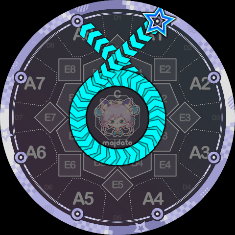

# プレイアビリティのデザインのヒント

MajdataPlay はスライドコードに対応したため、スライドコードを使った譜面は実際の筐体でプレイできます。そのため、従来の自作譜面を作るときと同じように、最初から観賞用譜面を意図している場合を除き、配置を書く際にはプレイ体験を考慮する必要があります。

まず、初見での読みづらさについて述べます。スライドコードで書かれたスライドは、一般にプレイヤーがこれまで見たことのない形状です。[見た目のデザインのヒント](./appearance) で述べたように意図的に公式のスライド形状へ「擬態」させている場合を除き、プレイヤーにとって初見の負担はかなり大きく、率直に言えば「理解できない」ものになります。

この点は、Festival 時代の連結スライドを使う場合とよく似ています。形状が複雑で「先進的」であるほど、前後に他の要素がない状況で、しかも「解体」に十分な時間を確保して登場させるべきです。そのため、前述のような対称性や各種の図形押しを利用した長いスライドは、長いスライドを置ける休憩区間、例えばポップスならサビ後のブリッジ、エレクトロニックミュージックならドロップ後のブレイクなどに置くのが適しています。ノート密度が比較的高い区間には、公式の形状に近い単純なスライドコード（あるいはスライドコードをまったく使わないこと）が適しています。

特筆すべきは、「同じ円を何度も周回する」スライドです。例えば次の `1P00000K8` のようなものです。これはプレイヤーの視点から見ると実に読みづらく、何周すればよいかを直接見て取るのが難しいためです。そのため、こうした形状は遅いスライドに向いており、ここでもプレイヤーに「解体」の時間を与えることになります。

一般に、同じ円を 1 周半程度より多く周回する場合、周回数を一目で判断するのは難しくなります（しかも 1 周半でもすでに十分長く、軌道の長いスライドは本来速いテンポには向いていません）。

次は、内側スクリーンでの無理押しという定番の話題です。これはスライドがあるたびに考える必要があることですが、今は譜面を書いた後に DJAuto にチェックさせられるので、ここでは詳しく述べません。

本質的に、プレイアビリティに関する問題は、条件が許すなら MajdataPlay を起動して一度通しでプレイしてみるのが何よりのアドバイスです。それができない場合でも、少なくとも PC の画面に向かって手を動かしてみれば 80% の問題は解決できます。スライドコードのように自由度の非常に高い構文を使った譜面では、なおさらです（観賞用譜面でない場合）。
