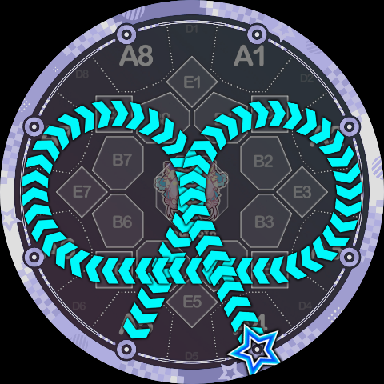
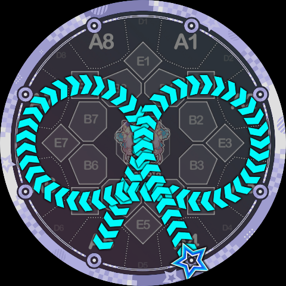
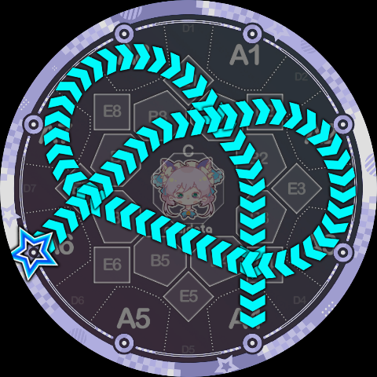
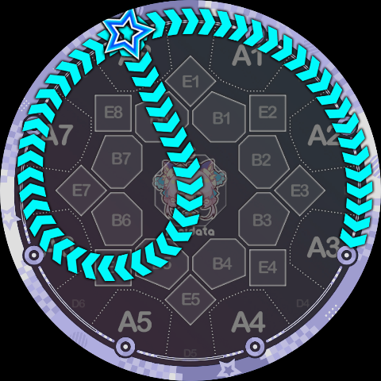
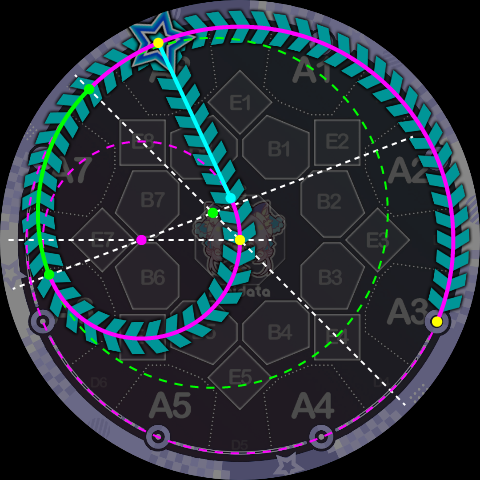
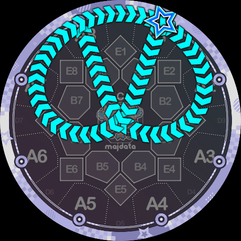
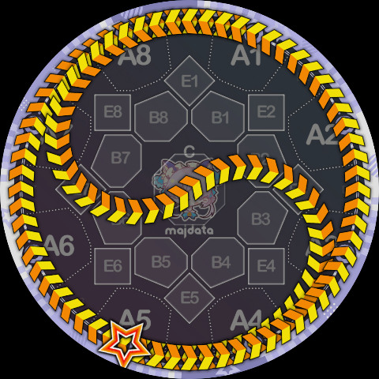

# トラック間の遷移

トラック命令の後に別のトラック命令が続く場合、**同じ回転方向の接続だけが許可されます**。つまり P は P にのみ、Q は Q にのみ接続できます。P と Q を接続する必要がある場合は、その間にノード命令を仲介として挿入しなければなりません。

同じトラックが 2 つ続く特殊な場合、例えば `P1P1`（省略形では `P11`）は、前述のとおりこのトラックを 1 周することを意味し、周回数を明示するために使います。

異なる 2 つのトラックを使う場合の意味は、トラックの移行です。10 個のトラックのうち任意の 2 つの間では、**中央円と最外周円の間を除いて**、すべての移行が許可されています（つまり `P09` や `Q90` は許可されません）。

**中央円と 8 個のサイド円の間**（つまりトラック 0~8 の間）では、**トラックの移行は 1 本の外公接線によって行われます**。2 つの円には 2 本の外公接線があり、パーサーは現在の回転方向に応じて正しい方を自動的に選択します。ここでは例を直接見てみましょう。次の図の軌道は `4Q37K5` と記述され、3 番円から 7 番円へのトラック移行を含んでおり、それが外公接線です。

比較として、通過する 2 つの B エリア、すなわち B4 と B5 を「当然のように」中継ノードとして使うと、`4Q3B45Q7K5` は次のようになります。途中に折れ点が現れており、両者の見た目が同じではないことが分かります。

中央円を使ったもう 1 つの例です。`6Q0380K4` は少し三つ葉結び目に似ています。

次に、サイド円と最外周円の間の移行（つまりトラック 1~8 とトラック 9 の間）です。**サイド円は最外周円に内包されており共通接線がないため、特定の共通接線円を移行経路として使用します**。ここでも例を直接見てみましょう。`8Q79K3` は、見た目は `8qq7>3` に似ていますが、つながりがより滑らかです。

パスの各部分をより具体的に示すこともできます。

上の図で、緑色の円弧が `Q79` のトラック移行部分です。これは緑色の破線円の一部であり、この破線円は最外周円と 7 番サイド円の共通接線円です。この共通接線円と最外周円の接点はちょうど D8 エリアの中心になります。そのため、最外周円から 1 番サイド円への 2 回目のトラック移行によって、この共通接線円の残りの部分を補完できます。次の図は `1Q892K8` で、A7 A8 A1 A2 の部分は実際には連続した円弧です。

上の `1Q892K8` で、`Q9` 命令の回転角度が実際には 0° であることに気づく人もいるかもしれません。`Q89` の移行終点と `Q92` の移行始点が、実際には同じ接点だからです。実はこれは、スライドコードのパーサーが意図的に残した特殊なケースです。この移行の共通接線円は半径が十分に大きいため、図の A8 から A1 までの円弧は見た目上ほぼ判定線上にあり、この場合に限り 0° の回転角度が許可されています。

これで、次の図の陰陽魚スライドをスライドコードで表した形、`5P98CQ49K1` を解析できるようになりました。

