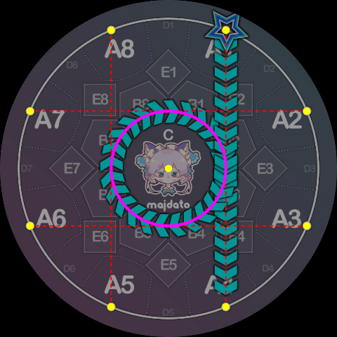
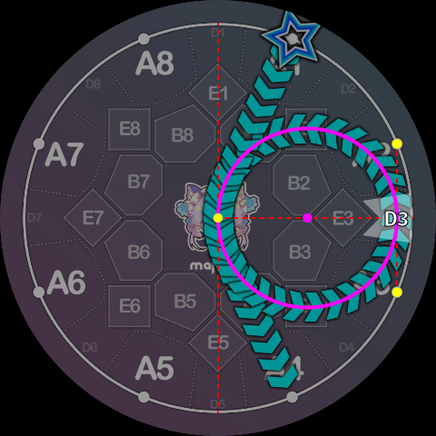
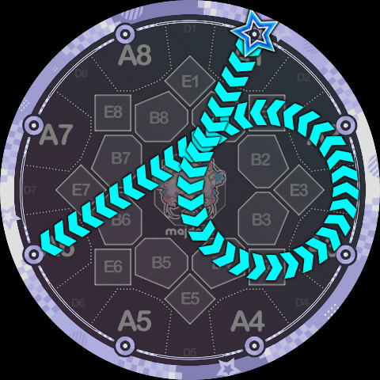
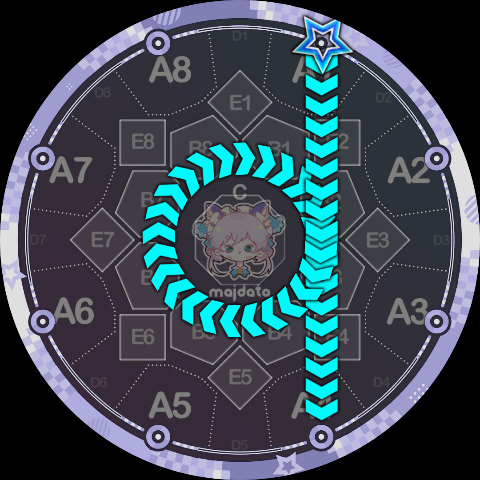
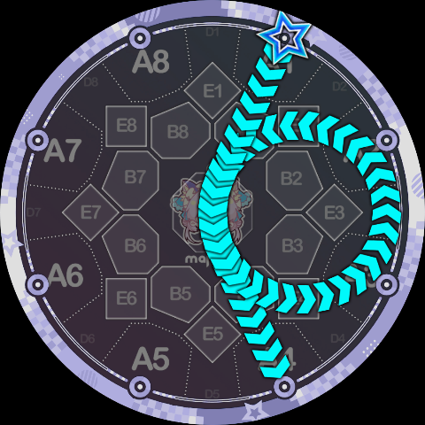
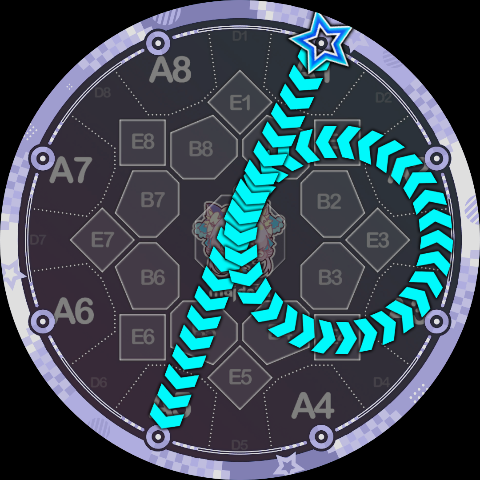
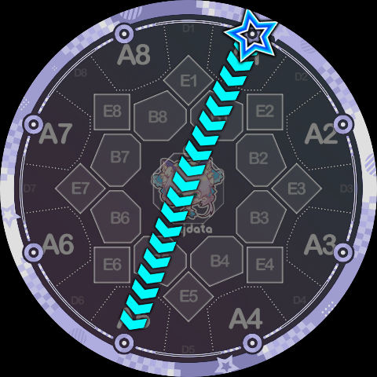
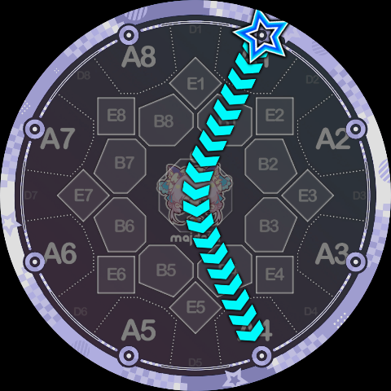
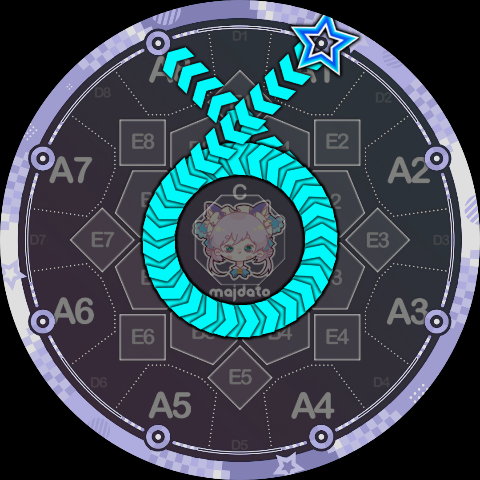

# トラック命令

これらの命令は、スライドが**特定の円形トラックに沿って回転する**ことを要求します。パスの始点が円の外側にある場合は、まず接線に沿って円へ入り、それから回転します。トラックを離れて別の場所へ向かう場合は、適切な角度まで回転してから接線に沿って離脱します。

公式のスライド形状には 10 個の異なる円があります。スライドコードでは、それぞれに `0~9` の番号を割り当てています。

* サイド円：標準構文の ppqq スライドが周回する円で、全部で 8 個あります。便宜上、サイド円の番号は通過する D エリアのキー番号と一致しており、`1~8` の範囲を取ります。（例えば標準構文の `1pp4` が周回する円は D3 を通過するため、3 番円です）
* 中央円：標準構文の pq スライドが周回する円です。どの D エリアも通過しないため、`0` 番が割り当てられています。
* 最外周円：標準構文の `<` と `>` のスライドが周回する円、すなわち判定線そのものです。すべての D エリアを通過するため、最大の番号である `9` が割り当てられています（残った番号はこれだけです）。

中央円の具体的な定義は次の図のとおりです。

サイド円の定義です（図は 3 番円）。

最外周円は判定線そのものなので、説明は不要でしょう。

回転は時計回りにも反時計回りにもできます。スライドコードは標準 simai の `p, q` という記法を借用し、次の 2 つのトラック命令を定義しています。

* **P 命令**：指定した円の周りを**反時計回り**に回転します。パラメータは `0~9` で、具体的な円の番号を表します。
* **Q 命令**：指定した円の周りを**時計回り**に回転します。パラメータは `0~9` で、具体的な円の番号を表します。

この 2 つのトラック命令を使えば、公式のスライド形状をスライドコードに変換できます。

`1pp6 = 1P3K6` は、1 番キーから出発し、3 番円の周りを反時計回りに回転してから、6 番キーで終わる軌道です。

`1q4 = 1Q0K4` は、ちょうど 360° 回転する場合です。

`1>1 = 1Q9K1` も、同じくちょうど 360° の回転です。

公式の `1pp4` と `1pp5` は、周回する中心角が 360° を超えるため特殊です。この場合、スライドコードではトラック命令を繰り返して「追加で 1 周する」ことを表します。

`1pp4 = 1P3P3K4` では、繰り返された `P3` が 3 番円を追加で 1 周することを意味します。

`1pp5 = 1P3P3K5` です。サイド円の形状定義を見返すと、ここがちょうど 360° ではなく 360° を超える理由が理解できるはずです。

もちろん、これは意図的に追加の 1 周を行わないこともできるという意味です。例えば次のとおりです。

`1P3K5` は `1-5` によく似ていますが `1-5` ではありません（軌道がわずかに左へ曲がっている点に注意してください）。

`1P3K4` は `1v4` によく似ていますが `1v4` ではありません。

追加で 1 周を要求できるということは、当然もっと多くの周回も可能です。例えば `1P0P0P0P0P0K8` は合計 4.75 周します。

