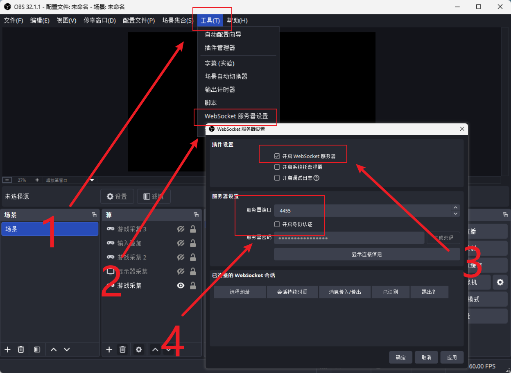

# 录制

MajdataPlay 支持两种录制方式:

| 模式 | 平台 | 说明 |
| --- | --- | --- |
| `OBSTrigger` | 仅桌面端 | 通过 OBS WebSocket 控制 OBS 录制, 适合需要自定义场景、摄像头或叠层的场景 |
| `FFmpeg` | 桌面端和移动端 | 使用内置 FFmpeg 录制游戏画面和音频, 输出到 `RecordOutputs` |

录制模式在 `system-settings.json` 的 `Common.RecordMode` 中设置, 默认值为 `"Disable"`.

## 使用内置 FFmpeg 录制

1. 将 `system-settings.json` 中的 `Common.RecordMode` 改为 `"FFmpeg"`.
2. 重启游戏. 设置界面中会出现 **Encoding** 菜单.
3. 在 **Encoding** 中设置容器、编码器、帧率、码率和分辨率缩放.
4. 开始游玩; 录制会在游戏开始时自动开始, 在退出乐曲或游戏结束时自动保存.

默认输出为 MP4, 文件位于游戏数据目录下的 `RecordOutputs` 文件夹, 文件名类似 `曲名_谱师_2026-01-01_12_00_00.mp4`. 如果封装音轨失败, 会保留一个仅视频的 `.mkv` 文件.

### 编码建议

- 桌面端优先使用 `Hardware`; 如果画面花屏、录制失败或驱动不支持, 切换为 `Software`.
- 移动端建议保持 `Hardware`, 由系统硬件编码器处理. 如果设备过热或掉帧, 降低 `ResolutionScale`、`FrameRate` 或 `BitRate`.
- `RateControlMode` 为 `VBR` 时可以设置 `MaximumBitRate`; 直播或上传平台有码率限制时请自行调整.
- 录制会占用 GPU、CPU 和存储空间. 长时间录制前请确认剩余空间.

### 移动端

Android 和 iOS 都可以使用 `FFmpeg` 模式. 输出文件位于应用数据目录下的 `RecordOutputs`:

- Android 授予存储权限时: `Documents/MajdataPlay/RecordOutputs`
- Android 未授予存储权限时: `Android/data/net.majdata.majdataplay/files/RecordOutputs`
- iOS: `MajdataPlay` 文件夹下的 `RecordOutputs`

移动端不建议使用 `OBSTrigger`; 该选项在移动端不可选.

## 使用 OBS 录制

OBS 模式仅支持桌面端. 本功能的原理是请小小蓝白帮你按录制键, 所以请先在 OBS 内配置好场景, 将 MajdataPlay 使用<mark>屏幕录制或游戏录制</mark>捕获, 如使用其他捕获模式可能无法录制.

1. 点击顶部的`工具`
2. 点击下拉菜单中的`WebSocket 服务器设置`
3. 勾选`开启 WebSocket 服务器`
4. 将`服务器端口`设置为`4455`并<mark>取消</mark>勾选`开启身份认证`

然后在 `system-settings.json` 中把 `Common.RecordMode` 设为 `"OBSTrigger"`.

## 录制状态

录制模式启用后, 进入游玩时副屏的小小蓝白下方会显示摄像头图标:

- 未连接: 录制器尚未准备好
- 已连接: 录制器已准备好
- 录制中: 正在录制当前游玩

::: tip
无论是 OBS 还是 FFmpeg, 录制状态图标都表示当前录制器是否连接和是否正在录制.
:::
